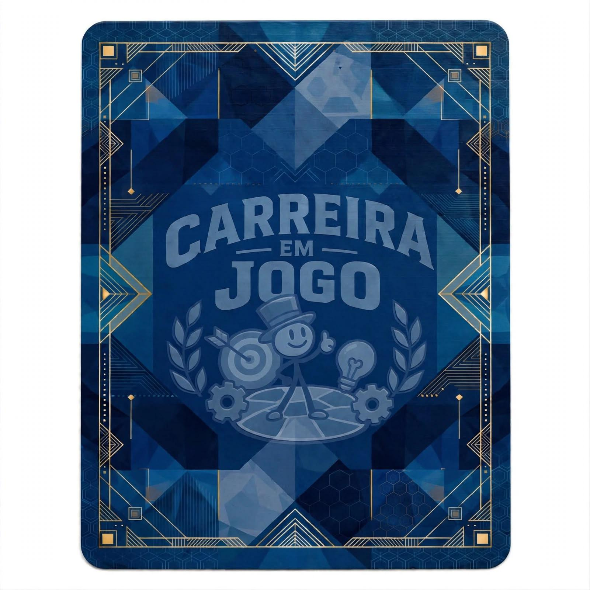
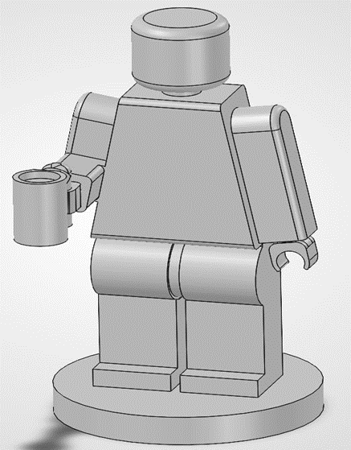
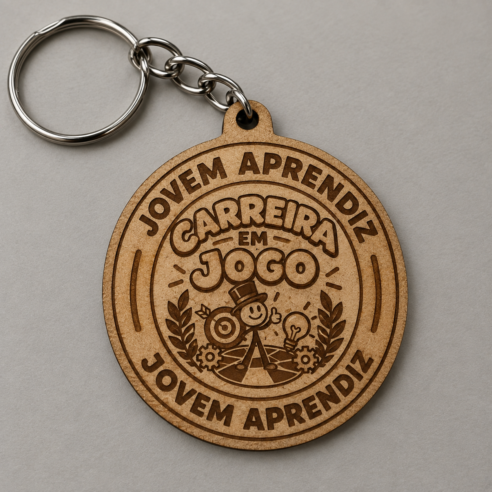
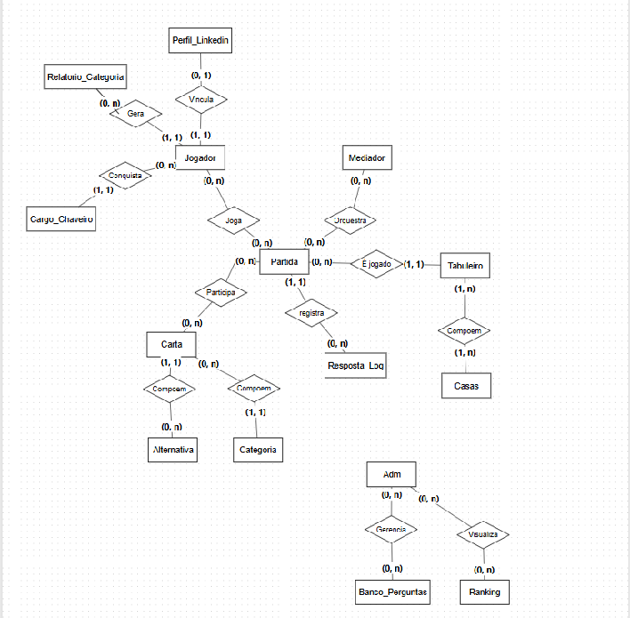
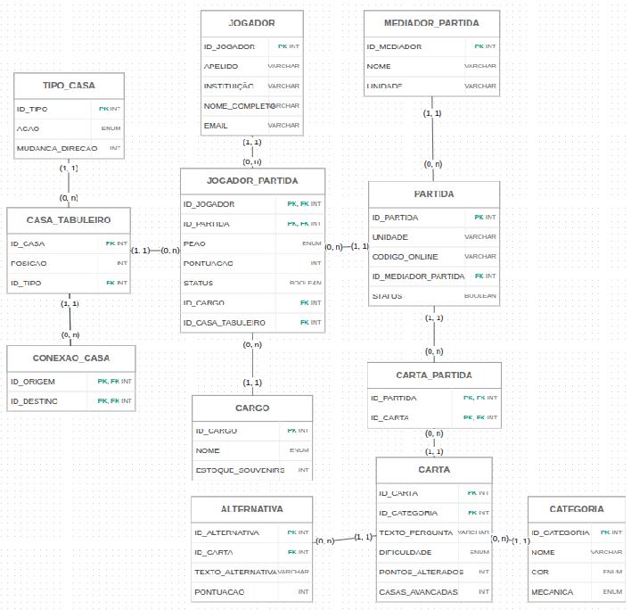
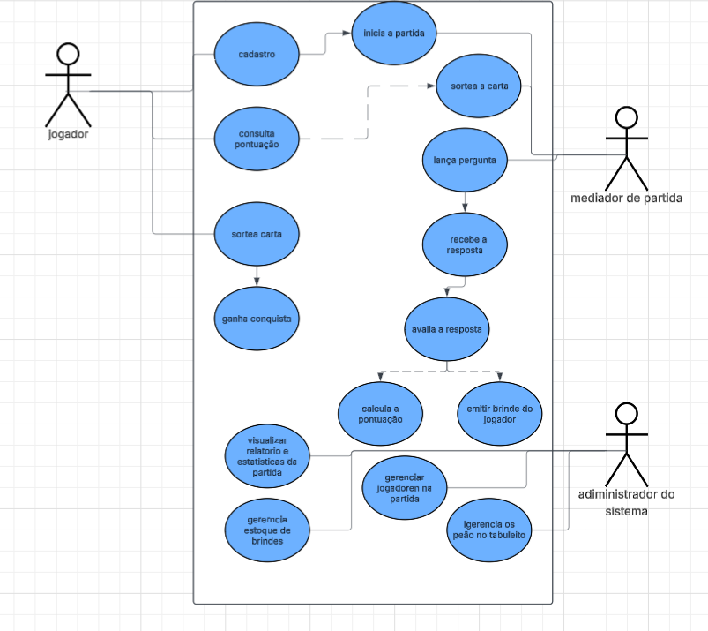
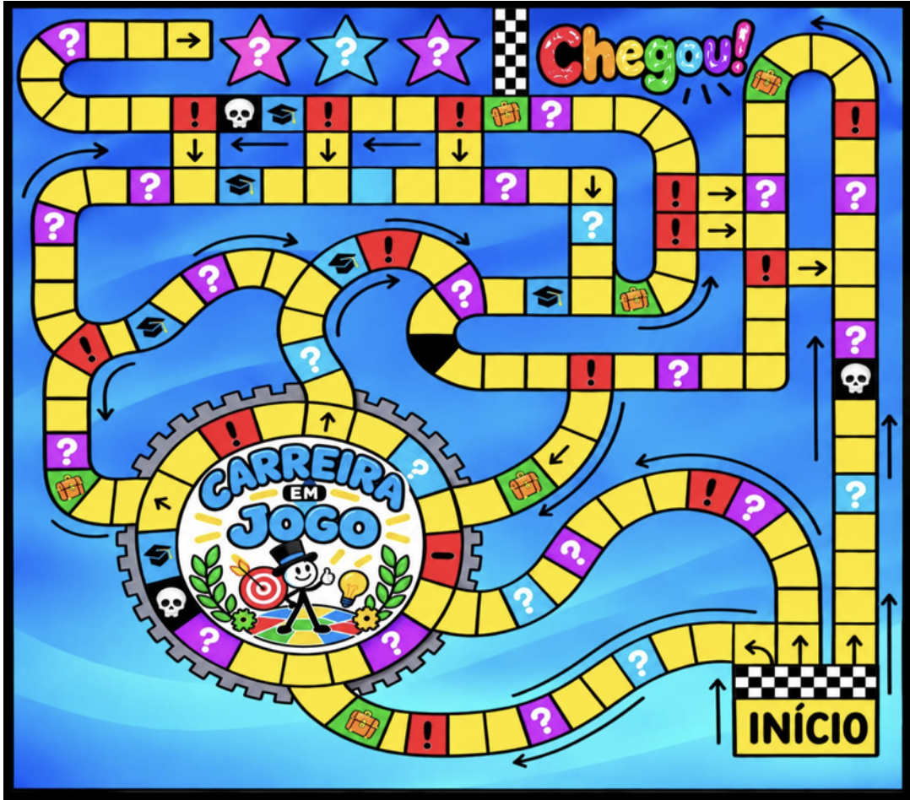
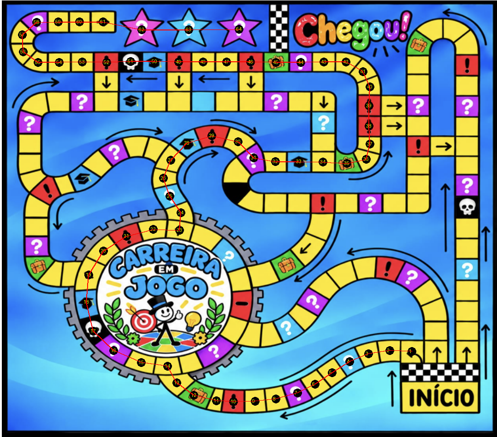
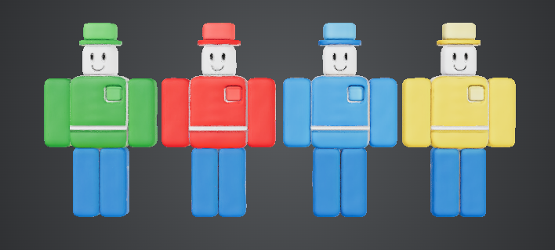
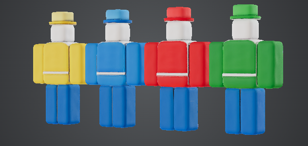

# Carreira em Jogo — Documentação Consolidada

> Estudo completo da documentação produzida pelos alunos da turma de Aprendizagem Industrial em Assistente Administrativo (SENAI Videira/SC), registro de como cada item foi levado para a versão web (fase 1) e das correções pedidas depois pelo usuário (fase 2, §14).
>
> **Convenção usada neste documento**
> - **[DOC]** — o que está escrito na documentação original, sem interpretação.
> - **[DECISÃO]** — ponto em que a documentação é omissa, ambígua ou contraditória e foi preciso escolher um comportamento. Todas as decisões estão reunidas no §11: as da fase 1 nos itens 1 a 36 e as da fase 2 do item 37 em diante.
> - **[BUG-DOC]** — erro encontrado na própria documentação (por exemplo, um SQL que não funciona como descrito).
> - **Fase 2** — as regras vêm do relatório e das respostas do usuário (§14), e o código é a fonte da verdade. As linhas **[DOC]** continuam como os alunos escreveram; quando divergem da fase 2, vale o §14.

## Sumário

1. [Fontes analisadas](#1-fontes-analisadas)
2. [O projeto](#2-o-projeto)
3. [Componentes físicos e materiais](#3-componentes-físicos-e-materiais)
4. [Perfis de usuário e permissões](#4-perfis-de-usuário-e-permissões)
5. [Requisitos funcionais (RF01–RF10)](#5-requisitos-funcionais-rf01rf10)
6. [Requisitos não funcionais (RNF01–RNF06)](#6-requisitos-não-funcionais-rnf01rnf06)
7. [Modelagem de dados](#7-modelagem-de-dados)
8. [Casos de uso (UML)](#8-casos-de-uso-uml)
9. [O tabuleiro](#9-o-tabuleiro)
10. [Personagens, cartas e brindes](#10-personagens-cartas-e-brindes)
11. [Inconsistências, lacunas e decisões das fases 1 e 2](#11-inconsistências-lacunas-e-decisões-das-fases-1-e-2)
12. [Implementação web (fases 1 e 2)](#12-implementação-web-fases-1-e-2)
13. [Fluxo completo de uma partida](#13-fluxo-completo-de-uma-partida)
14. [Fase 2: correções](#14-fase-2-correções)

---

## 1. Fontes analisadas

| Arquivo | Conteúdo | Observação |
|---|---|---|
| `panorama_geral.pdf` (8 páginas) | Projeto de Intervenção Pedagógica e Extensão Institucional Mundo SENAI 2026: identificação, justificativa, objetivos, dinâmica, componentes físicos, lista de materiais, considerações finais | Inclui imagens do logo, do tabuleiro, do verso da carta, do peão 3D e do chaveiro |
| `requisitos funcionais.md` | RF01–RF10 e RNF01–RNF06 com campos de tela, regras de funcionamento e exemplos de SQL/CSS; descrição dos 4 perfis de usuário | Documento mais detalhado e operacional — usado como **fonte principal do comportamento** |
| `BANCO DE DADOS.md` | Levantamento de entidades e atributos, ideia de medalha virtual no LinkedIn, DER e Modelo Lógico (2 imagens embutidas) | Imagens extraídas para `docs/img/bd-der.png` e `docs/img/bd-modelo-logico.png` |
| `DIAGRAMA UML.md` | Diagrama de casos de uso (atores, responsabilidades, fluxo) e explicação do modelo lógico (2 imagens embutidas) | Imagens extraídas para `docs/img/uml-casos-de-uso.png` e `docs/img/uml-modelo-logico.png` |
| `design-personagens.md` | 6 imagens dos 4 peões coloridos e 1 imagem do personagem "ADM (O Dono da partida)" | Imagens extraídas para `docs/img/personagem-1.png` … `personagem-7.png` |
| `TABULEIRO.png` (1078 × 948 px) | Arte do tabuleiro | Mapeado casa a casa no §9 |

As imagens que estavam embutidas em base64 nos arquivos `.md` foram extraídas para `docs/img/` para poderem ser vistas e referenciadas.

---

## 2. O projeto

### 2.1 Identificação [DOC]

| Campo | Valor |
|---|---|
| Nome do projeto | Carreira em Jogo (nas considerações finais: "Carreira em Jogo: Tabuleiro Gigante de Orientação Profissional") |
| Evento | Mundo SENAI 2026 |
| Docente responsável | Prof. Carlos Alexandre dos Santos |
| Curso executante | AI em Assistente Administrativo |
| Turma | Aprendizagem Industrial — Turno Vespertino |
| Unidade | SENAI Videira / SC |
| Data de submissão | Setembro de 2026 |


### 2.2 Apresentação [DOC]

Ferramenta pedagógica gamificada em formato gigante (**3,00 m × 3,00 m**). É um tabuleiro horizontal interativo no conceito de **Human Board Game**: os próprios participantes são os "peões" sobre o tablado. Guia os jogadores por uma jornada que representa a vida profissional, **da entrada no mercado até a maturidade na carreira**.

- Desenvolvido e operado pelos estudantes de Aprendizagem Industrial em Assistente Administrativo do SENAI Videira.
- Combina **dados gigantes de espuma** e **rodadas de perguntas e respostas** contextualizadas.
- Público: alunos do **6º ano do Ensino Fundamental ao 3º ano do Ensino Médio** das escolas da região de Videira, além de turmas dos cursos técnicos e de aprendizagem da própria unidade.

### 2.3 Justificativa [DOC]

- A transição escola → mercado de trabalho é desafiadora; exposições teóricas de orientação profissional engajam pouco.
- A gamificação (metodologia ativa) transforma conceitos complexos — **ética corporativa, gestão do tempo, educação financeira e rotinas administrativas** — em experiências assimiláveis. *(Estes são os quatro temas que viram as quatro categorias de perguntas.)*
- O tamanho gigante tem apelo visual, sensorial e participativo; o jovem deixa de ser espectador e toma decisões em tempo real.
- Para a turma executora, o projeto é um **laboratório vivo**: concepção do jogo, logística, gestão do fluxo de participantes e mediação das partidas.

### 2.4 Objetivos [DOC]

**Geral:** desenvolver e aplicar uma ferramenta ludopedagógica em formato de tabuleiro gigante para disseminar conhecimentos sobre mercado de trabalho, rotinas administrativas e planejamento de carreira, promovendo o protagonismo dos aprendizes na mediação e gestão da atividade.

**Específicos — turma executora (Assistente Administrativo):**
- Planejar, estruturar e executar todas as etapas de um evento pedagógico institucional.
- Mobilizar comunicação interpessoal, mediação de conflitos, liderança e organização de processos.
- Consolidar os conhecimentos do curso ao elaborar o banco de perguntas e desafios práticos.

**Específicos — público atendido:**
- Compreender, de forma prática e lúdica, aspectos da vida profissional, atitudes éticas e rotinas corporativas.
- Conhecer o SENAI Videira e a relevância da formação técnica e profissionalizante.
- Refletir sobre escolhas de carreira, trabalho em equipe e postura profissional.

### 2.5 Alinhamento institucional [DOC]

- **MSEP** (Metodologia SENAI de Educação Profissional): formação por competências, protagonismo, metodologias ativas; os aprendizes resolvem um problema real (recepcionar, orientar e conduzir grupos numa atividade gamificada).
- **Unidades curriculares mobilizadas:** Comunicação e Redação Técnica (escrita do projeto, formulação das perguntas, comunicação na mediação); Organização de Eventos e Logística (espaço, tempo das rodadas, recepção, conservação); Rotinas Administrativas e Ética (domínio técnico para validar respostas e mediar discussões); Trabalho em Equipe e Soft Skills.
- **Estratégia da unidade:** ativo de divulgação institucional (marketing pedagógico) em portas abertas, feiras de profissões e visitas de escolas parceiras. Estrutura durável, portátil e reutilizável, que passa a integrar o acervo da unidade.

---

## 3. Componentes físicos e materiais

> **Decisão da fase 2:** o jogo é totalmente digital (§14.7). Este capítulo e os trechos [DOC] sobre tabuleiro físico, dados gigantes e peões humanos registram o projeto original dos alunos e não descrevem o sistema.

### 3.1 Componentes [DOC]

| # | Componente | Especificação |
|---|---|---|
| 1 | Tabuleiro | MDF (ou pinus/compensado), **9 placas de 1 m × 1 m** formando 3 m × 3 m, caracterizadas e pintadas |
| 2 | Dados gigantes | Espuma ou tecido, **20 cm × 20 cm**, revestidos com material lavável |
| 3 | Cartões de desafios | **100 unidades**, divididos em **4 baralhos temáticos** organizados por cores impressas em papel foto (item 4.1 do PDF; a lista de materiais do PDF, item 4.2.2, diz "100 cartas impressas em papel cartão 12 cm × 8 cm" — ver §3.2) |
| 4 | Peões personalizados | **4 unidades**, bonecos com temas profissionais da indústria, impressos em 3D (PLA verde, vermelho, azul e amarelo) |
| 5 | Souvenirs | **300 chaveiros** com a personalização do **nível que o participante atingiu** no jogo (MDF 3 mm cortado a laser) |

| Verso da carta | Peão 3D | Chaveiro |
|---|---|---|
|  |  |  |

### 3.2 Lista de materiais [DOC]

- **Tabuleiro:** 9 placas de MDF 1 m × 1 m (12 ou 15 mm); 7,2 L de tinta branca acrílica; 1 m de lixa 220; bisnagas de pigmento à base de água nas cores **preto, vermelho, roxo, rosa, verde, azul e amarelo** (as 7 cores do tabuleiro); 2 latas de verniz spray 300 ml; 6 canetões acrílicos pretos; 3 potes de glitter dourado; 3 rolos de espuma 15 cm; 2 rolos de espuma 9 cm; 2 pincéis de cada tamanho 00, 01, 02, 04, 06, 08 e 10 (materiais emprestados); 30 folhas A4; 1 rolo de fita crepe.
- **Cartões:** material impresso em adesivo para finalização; 100 cartas em papel cartão 12 cm × 8 cm.
- **Decoração:** 4 pacotes de balões coloridos; 1 rolo pequeno de barbante de algodão; 10 m de TNT azul.
- **Peões:** 1 rolo de filamento PLA de cada cor: verde, vermelho, azul, amarelo.
- **Chaveiros:** 4 placas de MDF 3 mm branco 30 cm × 70 cm (corte a laser); 300 argolas.
- **Ambiente:** 1 sala grande com DataShow; 1 mesa.

---

## 4. Perfis de usuário e permissões

A documentação descreve os perfis em dois lugares: no final de `requisitos funcionais.md` (4 perfis do **evento**) e no `DIAGRAMA UML.md` (3 **atores** do sistema). O RNF04 define os 2 perfis de **login**.

| Perfil (requisitos) | Quem é [DOC] | O que pode fazer [DOC] | Ator UML | Login no sistema |
|---|---|---|---|---|
| **Administrador** (Coordenação e Supervisão) | Prof. Carlos Alexandre dos Santos e a Supervisão de Unidade do SENAI Videira | Aprovar compras e orçamento; revisar e aprovar o banco de perguntas e cartas; alterar regras, dinâmicas e a estrutura da atividade; avaliar os alunos; acompanhar relatórios de participação das escolas e resultados | administrador do sistema | **Administrador** |
| **Mediador / Operador** | Alunos da turma de Assistente Administrativo (vespertino) | Escrever e organizar o banco de perguntas e os 4 baralhos; recepção e cadastro dos visitantes; iniciar, pausar e controlar o tempo de cada partida; ler os desafios, conferir respostas e dar o veredito; registrar pontuações e distribuir os chaveiros; cuidar dos equipamentos | mediador de partida | **Mediador** |
| **Jogador / Peão humano** | Alunos do 6º EF ao 3º EM das escolas da região e turmas do SENAI | Lançar os dados gigantes; responder às cartas e encarar os desafios; deslocar-se pelas casas; receber o chaveiro do nível alcançado | jogador | não faz login (é cadastrado na Recepção) |
| **Espectador** | Professores das escolas parceiras, pais e visitantes | Assistir às partidas da área da plateia e ver os slides no DataShow; pegar materiais informativos | — | não faz login (telão público) |

**RNF04 — menus por perfil [DOC]:** Mediador vê só **Recepção**, **Nova Partida** e **Estoque de Brindes**; Administrador vê também o **Painel Admin** (Perguntas — RF10 e Escolas — RF02). Se um mediador digitar uma URL de administração (ex.: `/admin/perguntas`), o sistema bloqueia e exibe *"Acesso Negado: Você não tem permissão para visualizar esta página"*.

> Observação: os alunos "escrevem e organizam o banco de perguntas", mas o RF10 diz que **apenas o professor** cadastra/edita perguntas no sistema. A leitura coerente é: a turma escreve as cartas fora do sistema; o docente revisa, aprova e cadastra.

---

## 5. Requisitos funcionais (RF01–RF10)

Para cada requisito: o que a documentação diz **[DOC]**, a análise e como foi implementado. As linhas **[DOC]** registram o texto dos alunos; as correções da fase 2 (§14) estão nas linhas de Análise, **[DECISÃO]** e Implementação.

### RF01 — Cadastro de jogadores (módulo Cadastro)
**[DOC]** Cadastro de novos jogadores com nome, e-mail e escola de origem.
- Campos: **Nome Completo** (obrigatório), **E-mail** (opcional), **Escola de Origem** (obrigatório, escolhida numa lista).
- Regras: não salva com nome ou escola em branco; se o e-mail for preenchido, confere o formato (com "@"); o mediador não digita a escola, apenas escolhe na lista (evita erros nos relatórios); ao salvar, aviso de sucesso e campos limpos para a próxima pessoa.
- SQL: `INSERT INTO TB_JOGADOR (nome, email, id_escola) VALUES ('Nome', 'email@email.com', 1);`

**Análise:** o levantamento de entidades (`BANCO DE DADOS.md`) também lista **apelido** (que reaparece no Modelo Lógico como JOGADOR.APELIDO) e usa o e-mail "para criação da medalha virtual". **[DECISÃO]** O campo **Apelido** (opcional) foi incluído; ele aparece no telão no lugar do nome completo (sem apelido, aparece o primeiro nome).
**Implementação:** tela **Recepção** (`/recepcao`), `POST /api/jogadores`.

### RF02 — Cadastro de escolas (módulo Cadastro)
**[DOC]** Cadastro prévio das escolas visitantes. Campos: **Nome da Escola** e **Cidade** (ambos obrigatórios). Não permite duas escolas exatamente com o mesmo nome. O administrador vê a lista, corrige o nome ou apaga.
- SQL: `INSERT INTO TB_ESCOLA (nome, cidade) VALUES ('Nome da Escola', 'Nome da Cidade');`

**Análise:** **[DECISÃO]** a duplicidade é verificada ignorando maiúsculas/minúsculas e espaços nas pontas ("SENAI Videira" = "senai videira "), que é o objetivo declarado (evitar confusão nos relatórios). **[DECISÃO]** uma escola que já tem jogadores cadastrados não pode ser excluída (a exclusão quebraria o histórico e os relatórios); o sistema avisa o motivo.
**Implementação:** **Painel Admin → Escolas** (`/admin/escolas`), `GET/POST/PUT/DELETE /api/escolas`. O seed cria "SENAI Videira — Videira".

### RF03 — Iniciar partida (módulo Partida)
**[DOC]** O mediador inicia uma nova partida vinculando **de 1 a 4 jogadores** já cadastrados; não pode selecionar a mesma pessoa duas vezes; ao clicar em **Iniciar**, o status vira **"Em Andamento"** e a tela do dado é liberada.
- SQL: `INSERT INTO TB_PARTIDA (status) VALUES ('Em Andamento');`

**Análise:** o SQL do RF não liga os jogadores à partida; o Modelo Lógico resolve isso com **JOGADOR_PARTIDA** (peão escolhido, pontuação, status, casa atual). O caso de uso diz que o mediador "inicia a partida e **compartilha o código da sessão**" (PARTIDA.CODIGO_ONLINE).
**Implementação:** tela **Nova Partida** (`/nova-partida`): busca de jogadores, até 4, sem repetição, escolha do **peão** (verde, vermelho, azul, amarelo — as cores dos peões impressos em 3D) e da **rota** (Esquerda, Centro ou Direita, com Esquerda como padrão; §9.4); gera um **código de 6 caracteres** para o telão. `POST /api/partidas`.

### RF04 — Valor do dado (módulo Partida)
**[DOC]** O mediador insere o valor do **dado físico** (1 a 6) para o jogador da vez.
- Campo: **Valor do Dado** — o ideal são **6 botões grandes numerados de 1 a 6**.
- Regras: mostrar claramente **de qual jogador é a vez**; só aceita 1 a 6; **cálculo automático**: posição atual + dado = casa onde vai parar (ex.: estava na casa 2, tirou 4, vai para a 6).
- SQL: `INSERT INTO TB_JOGADA (id_partida, id_jogador, casa_final) VALUES (1, 2, 6);`

**Análise:** a regra "posição + dado" pressupõe um **percurso linear numerado** — ver §9. Desde a fase 2, cada jogador segue a sequência da sua rota: o dado soma posições na rota, e não números de casa (no Centro, quem está na 119 e tira 1 vai para a 23). **[DECISÃO]** ao passar do fim, o peão para no "Chegou!" (não exige número exato). **[DECISÃO]** (fase 2, §14.7) o dado é sempre sorteado no servidor: o jogo é só digital e não há dado físico.
**Implementação:** tela da partida (`/partida/:id`), `POST /api/partidas/:id/dado`. O botão **Girar o dado** gira por 0,8 s, e o servidor sorteia com `randomInt(1, 7)`; um número enviado pela tela é ignorado. O peão anda casa a casa, pela rota do jogador, no tabuleiro digital. O efeito da casa acontece nesta chamada (§9.3): casa com pergunta abre a etapa de sortear, amarela passa a vez, caveira elimina e Chegou! abre a Premiação.

### RF05 — Sorteio da pergunta pela cor da casa (módulo Jogo)
**[DOC]** O sistema sorteia e exibe aleatoriamente uma pergunta **da categoria/cor da casa** em que o jogador parou.
- Tela: **texto da pergunta** grande; **categoria/cor** com indicação visual (ex.: o **fundo da tela muda para a cor da categoria**); **resposta correta** num campo oculto ou destacado para o mediador.
- Regras: o mediador não escolhe a pergunta; a tela destaca a cor (**Vermelho, Verde, Azul ou Amarelo**) para confirmar que bate com a casa física; o **gabarito já aparece** na tela.
- SQL: `SELECT enunciado, resposta FROM TB_PERGUNTA WHERE id_categoria = 2 ORDER BY RANDOM() LIMIT 1;`

**Análise:** a documentação nunca diz qual tema tem qual cor, e o tabuleiro tem 7 cores (§9.3). **[DECISÃO]** pareamento por posição das listas do RF05 e do RF10 — **Ética = Vermelho, Finanças = Verde, Rotinas = Azul, Gestão do Tempo = Amarelo** (ids 1 a 4). O exemplo do RF10 (pergunta da CLT gravada com `id_categoria = 3`) confirma Rotinas = 3. Esse pareamento continua valendo para a cor de cada categoria na tela da pergunta. **[DECISÃO]** (fase 2, §9.3) a cor **da casa** passou a seguir outra regra: vermelho → Ética, azul → Rotinas, **verde → Entrevista** (5ª categoria, id 5, verde-escuro) e **amarelo → sem pergunta**. Roxo, rosa e preto sem caveira são **casas-surpresa**, que sorteiam entre Ética, Finanças, Rotinas e Gestão do Tempo; preto com caveira elimina sem pergunta. Finanças e Gestão do Tempo só saem nas casas-surpresa. O gabarito na tela, pedido no RF05, saiu com as alternativas (RF07).
**Implementação:** botão **Sortear Pergunta** (citado no RNF03), sobreposição em tela cheia na cor da categoria, enunciado com a maior fonte da tela e as 4 alternativas, sem caixa de gabarito. `POST /api/partidas/:id/sortear`. A correção só sai da API da partida depois de a jogada ser respondida (§14.1).

### RF06 — Sem perguntas repetidas na partida (módulo Jogo)
**[DOC]** O sistema "lembra" de todas as perguntas já sorteadas na partida e as exclui do próximo sorteio — mesmo caindo várias vezes na mesma cor, as perguntas são sempre inéditas.
- SQL: `SELECT id_pergunta, enunciado, resposta FROM TB_PERGUNTA WHERE id_categoria = 3 AND id_pergunta NOT IN (SELECT id_pergunta FROM TB_JOGADA WHERE id_partida = 1) ORDER BY RANDOM() LIMIT 1;`

**[BUG-DOC]** Pelo RF04, a jogada é gravada **antes** de existir pergunta (id_pergunta vazio/NULL). Em SQL, `x NOT IN (…, NULL)` nunca é verdadeiro — **a consulta documentada não retornaria nenhuma pergunta a partir da primeira jogada**, travando o jogo. Correção mínima aplicada: `… WHERE id_partida = 1 AND id_pergunta IS NOT NULL`.
**[DECISÃO]** se acabarem as perguntas inéditas de uma categoria, o sistema avisa e oferece **Passar a vez** (nunca repete). Na casa-surpresa, o sorteio só considera as categorias que ainda têm pergunta inédita, sem a Entrevista. Com a casa amarela sem pergunta, esse caso deixou de aparecer nas simulações: ver §11 (item 13) e §14.5.
**Implementação:** `perguntaInedita` e `categoriaInedita` em `src/jogo.js`, índice único (`id_partida`, `id_pergunta`) em TB_JOGADA e `POST /api/partidas/:id/pular`, que só aceita passar a vez quando não há pergunta inédita para a jogada. Casa amarela e caveira gravam a jogada sem pergunta (`id_pergunta` NULL), então a correção do `IS NOT NULL` continua necessária.

### RF07 — Correta / Incorreta (módulo Jogo)
**[DOC]** Botões **"Correta"** (verde) e **"Incorreta"** (vermelho). O mediador compara a resposta falada com o gabarito. **Correta** → confirma o avanço do peão e registra os pontos. **Incorreta** → o jogador não ganha os pontos *(ou recua uma casa, dependendo da regra do tabuleiro físico)*. O clique é **obrigatório** para encerrar a jogada e passar a vez.
- SQL: `INSERT INTO TB_JOGADA (id_partida, id_jogador, id_pergunta, acertou, casa_final) VALUES (1, 2, 45, 1, 6);`

**Análise:** a quantidade de pontos não é definida no RF; o Modelo Lógico tem `CARTA.PONTOS_ALTERADOS` e `ALTERNATIVA.PONTUACAO`. Na fase 1, cada pergunta valia 10 pontos, editáveis, e o mediador avaliava a resposta falada. **[DECISÃO]** (fase 2, §14.1) os botões Correta e Incorreta saíram: o jogador escolhe A, B, C ou D, o mediador toca a letra e o **servidor corrige**. Na pergunta comum, a alternativa correta vale pela dificuldade (**Fácil 5, Médio 10, Difícil 15**) e as outras valem 0. Na Entrevista, cada alternativa vale 15, 10, 5 ou 0, e conta como acerto com pontos acima de 0. **[DECISÃO]** sem pontos, **o peão permanece** onde o dado levou; "recuar uma casa" não foi pedido na fase 2 e segue sem implementação (o tabuleiro físico não documenta essa regra).
**Implementação:** quatro botões `.botao-resposta.alternativa` na sobreposição da pergunta, `POST /api/partidas/:id/resposta` com `alternativa`. Depois da resposta, o painel do mediador e o telão mostram o resultado, a resposta certa (na Entrevista, a melhor) quando o jogador não a marcou, e a explicação (coluna `resposta`). Jogada encerrada sem resposta não revela nada.

### RF08 — Entrega do brinde (módulo Estoque)
**[DOC]** Registrar a entrega do **chaveiro** ao final da partida, de acordo com a pontuação/casa atingida.
- Tela: **resumo do jogador** (nome e casa final); **nível do brinde** (ex.: Chaveiro Nível **Iniciante, Intermediário ou Avançado**); botão **"Confirmar Entrega"**.
- Regras: **cálculo automático** pela `casa_final`; **um brinde por jogador por partida**; a partida só é **100% finalizada** depois de confirmar a premiação de **todos** os participantes.
- SQL: `INSERT INTO TB_ENTREGA_BRINDE (id_jogador, id_brinde) VALUES (2, 3);`

**[BUG-DOC]** a tabela documentada não tem `id_partida`, então a regra "um por jogador **por partida**" não teria como ser garantida — a coluna foi adicionada (com restrição única partida + jogador).
**[DECISÃO]** (fase 2, §14.2) o brinde segue o **cargo alcançado pela pontuação total**, e não a `casa_final`: Jovem Aprendiz 0, Estagiário 10, Coordenador 20, Gerente 35, Gerente Geral 50, Diretor de Área 60, Vice-Presidente 70 e CEO 80 pontos (ajustáveis pelo administrador). Na fase 1 eram faixas por terços do percurso: Iniciante casas 0–21, Intermediário 22–43, Avançado 44–65. **[DECISÃO]** o fim da partida acontece quando o primeiro jogador chega ao "Chegou!", quando o mediador clica em **Encerrar partida** (o perfil Mediador "controla o tempo de cada partida") ou, desde a fase 2, quando não sobra ninguém para jogar. Quem caiu na Casa da Morte recebe o chaveiro do cargo alcançado; quem foi removido pelo administrador, não.
**Implementação:** etapa **Premiação** da tela da partida, `POST /api/partidas/:id/entregas`. Cada cartão mostra pontos, casa final, cargo alcançado, chaveiro, estoque, **Confirmar Entrega** e o link do **Certificado** (§12.3).

### RF09 — Baixa automática no estoque (módulo Estoque)
**[DOC]** A cada entrega confirmada, o estoque diminui **na hora** (100 → 99). Se a quantidade chegar a **zero**, o sistema não dá baixa e **avisa que aquele modelo esgotou**. Substitui os "pauzinhos" no papel do Assistente Administrativo.
- SQL: `UPDATE TB_BRINDE SET quantidade_estoque = quantidade_estoque - 1 WHERE id_brinde = 3;`

**Implementação:** a entrega e a baixa acontecem na **mesma transação**; o banco também tem `CHECK (quantidade_estoque >= 0)`. Seed: **300 chaveiros divididos pela procura simulada de cada cargo** (§14.2; 300 no total, como no panorama geral; na fase 1 eram 100 por nível). Tela **Estoque de Brindes** (`/estoque`) mostra as quantidades, a faixa de pontos de cada cargo e o alerta **ESGOTADO**; o administrador repõe em **Painel Admin → Brindes**, onde também edita nome, cargo e pontos mínimos. Risco de esgotar: §14.5.

### RF10 — Banco de perguntas (módulo Admin)
**[DOC]** O Administrador (Docente) insere, edita e exclui perguntas.
- Campos: **Enunciado** (texto obrigatório), **Resposta (Gabarito)** (texto obrigatório), **Categoria** (dropdown com os 4 temas: **Ética, Finanças, Rotinas ou Gestão do Tempo**). Botões: **Salvar (Novo), Editar e Excluir**.
- Regras: tela **restrita ao professor**; não salva com campo em branco; alterações valem **imediatamente** para as próximas partidas.
- SQL: `INSERT INTO TB_PERGUNTA (enunciado, resposta, id_categoria) VALUES ('O que é a sigla CLT?', 'Consolidação das Leis do Trabalho', 3);` · `UPDATE TB_PERGUNTA SET enunciado = 'O que significa a sigla CLT?' WHERE id_pergunta = 10;` · `DELETE FROM TB_PERGUNTA WHERE id_pergunta = 10;`

**Análise:** o Modelo Lógico acrescenta à CARTA **dificuldade**, **pontos alterados** e **casas avançadas**, e uma tabela **ALTERNATIVA** (múltipla escolha com pontuação). **[DECISÃO]** (fase 2, §14.1) entraram **Dificuldade** e **ALTERNATIVA**: toda pergunta tem 4 alternativas e os **pontos não são digitados**, porque saem da dificuldade ou, na Entrevista, da nota de cada alternativa. O campo **Resposta (Gabarito)** virou a **explicação** mostrada depois da resposta, e o dropdown ganhou a 5ª categoria, **Entrevista**. "Casas avançadas" continua sem regra de uso na documentação e não foi implementada. Perguntas excluídas não apagam o histórico das partidas.
**Implementação:** **Painel Admin → Perguntas** (`/admin/perguntas`): enunciado, categoria, dificuldade, 4 alternativas (marca-se a correta; na Entrevista, a nota de cada uma) e explicação. Editar uma pergunta que está em jogo agora responde 409. O banco inicial tem **112 perguntas**: 25 em cada uma das 4 categorias dos requisitos (10 Fácil, 10 Médio e 5 Difícil) e 12 de Entrevista, incluindo a da CLT; são exemplos para a turma e o docente revisarem e substituírem.

---

## 6. Requisitos não funcionais (RNF01–RNF06)

| Código | Categoria | Requisito [DOC] | Como testar [DOC] | Implementação |
|---|---|---|---|---|
| **RNF01** | Usabilidade | Interface responsiva para tablets e notebooks do evento (mediadores em pé ao redor do tabuleiro 3×3 m) | Sem rolagem lateral; botões do tamanho do dedo; em tela larga lado a lado, em tela estreita empilhado. Exemplo: `@media (max-width: 768px) { .botao-resposta { width: 100%; font-size: 20px; } }` | Media query de 768 px **exatamente como no documento** (`public/css/style.css`); as alternativas A, B, C e D usam a classe `.botao-resposta` e, nessa largura, ocupam a largura toda, em uma coluna e com letra de 20 px (em tela maior, duas colunas; §11, item 35); tablet em pé (retrato até 1024 px) também empilha, como pede o texto do RNF01; `overflow-x: hidden`; alvos de toque ≥ 44–52 px; tela da partida com tabuleiro + painel lado a lado ou empilhados |
| **RNF02** | Usabilidade | Botões grandes e fontes de alta legibilidade no sorteio de perguntas | Pergunta é o maior destaque; Correta verde / Incorreta vermelho; espaço entre os botões. Exemplo: `.botao-correta { background-color: #28a745; font-size: 24px; padding: 15px 30px; }` | As classes `.botao-correta` e `.botao-incorreta` saíram com os botões (§14.1). O enunciado continua o maior destaque (`.enunciado`, até 64 px); as quatro alternativas (`.alternativa`) têm pelo menos 76 px de altura, letra de 20 a 26 px e 14 px de espaço entre si; o verde e o vermelho aparecem no aviso do resultado, depois da resposta |
| **RNF03** | Desempenho | Sortear e exibir a pergunta (RF05) em no máximo **2 s**; pelo detalhamento, o sistema não pode travar ou ficar "pensando" mais de **2 s** em nenhuma ação do mediador (ex.: sortear a pergunta, confirmar a entrega do chaveiro) | Sorteio quase instantâneo ao clicar em "Sortear Pergunta"; se passar de **1 s**, mostrar spinner. Uso de `LIMIT 1` | Banco local SQLite (consulta em milissegundos); o sorteio do dado e a correção da alternativa rodam no servidor, na mesma chamada; spinner automático após 1 s em toda chamada feita pela função `api()` (`public/js/app.js`); a consulta automática do telão a cada 2 s não usa spinner e, se a rede cair, mostra o selo "Sem conexão · tentando de novo…" |
| **RNF04** | Segurança | Login; mediador só opera o jogo; só administrador acessa perguntas e escolas | Menus por perfil; bloqueio de URL `/admin/...` com a mensagem "Acesso Negado…". Exemplo: `SELECT nome, perfil FROM TB_USUARIO WHERE email = '…' AND senha = 'senha_criptografada';` | Login por e-mail/senha; senha com **hash scrypt + sal** (verificada na aplicação, não no SQL); bloqueio no servidor tanto das páginas `/admin/*` quanto da API |
| **RNF05** | Portabilidade | Acessível por navegador (Chrome, Firefox, Edge, Safari), sem instalar nada, em Windows, Linux ou Android | HTML5 + CSS3 + JavaScript | HTML/CSS/JS puros, sem plugins; o servidor roda num notebook e os tablets acessam pela rede local |
| **RNF06** | Confiabilidade | Não perder a partida se a página for atualizada, a internet cair ou a bateria acabar | Cada ação gravada **na hora**; ao abrir **"Partida em Andamento"**, a tela volta exatamente na vez do jogador atual e com a casa/pontuação de cada um. Exemplo: `SELECT casa_final FROM TB_JOGADA WHERE id_partida = 1 AND id_jogador = 2 ORDER BY id_jogada DESC LIMIT 1;` | Dado, sorteio, resposta e entrega são gravados no momento do clique, em transação; a tela da partida é sempre reconstruída a partir do banco; menu **Partida em Andamento** lista as partidas para retomar |

---

## 7. Modelagem de dados

A documentação traz **três visões diferentes** do banco, feitas em momentos/grupos distintos.

### 7.1 Levantamento de entidades e atributos (`BANCO DE DADOS.md`) [DOC]

1. **jogador** — apelido, escola/instituição, nome completo, e-mail (para criação e envio da medalha virtual)
2. **mediador de partida** — nome completo, unidade
3. **tabuleiro** — casas (posição, tipo, número)
4. **categoria** — nome, cor, tipo de resposta
5. **carta** — categoria, texto da pergunta, dificuldade, pontos alterados, casas avançadas
6. **alternativa** — carta, texto da alternativa, pontos
7. **placar** — posição, jogador, pontuação
8. **partida** — jogadores/equipe (posição, peão, pontuação, cargo), unidade, código online, placar, data/hora

### 7.2 DER conceitual [DOC]



| Entidade | Relacionamento | Entidade |
|---|---|---|
| Perfil_Linkedin (0,1) | **Vincula** | (1,1) Jogador |
| Relatorio_Categoria (0,n) | **Gera** | (1,1) Jogador |
| Cargo_Chaveiro (1,1) | **Conquista** | (0,n) Jogador |
| Jogador (0,n) | **Joga** | (0,n) Partida |
| Mediador (0,n) | **Orquestra** | (0,n) Partida |
| Partida (0,n) | **É jogado** | (1,1) Tabuleiro |
| Tabuleiro (1,n) | **Compõem** | (1,n) Casas |
| Partida (0,n) | **Participa** | (0,n) Carta |
| Partida (1,1) | **Registra** | (0,n) Resposta_Log |
| Carta (1,1) | **Compõem** | (0,n) Alternativa |
| Carta (0,n) | **Compõem** | (1,1) Categoria |
| Adm (0,n) | **Gerencia** | (0,n) Banco_Perguntas |
| Adm (0,n) | **Visualiza** | (0,n) Ranking |

### 7.3 Modelo lógico [DOC]



| Tabela | Colunas (tipo) |
|---|---|
| TIPO_CASA | ID_TIPO (PK INT), ACAO (ENUM), MUDANCA_DIRECAO (INT) |
| CASA_TABULEIRO | ID_CASA (PK INT), POSICAO (INT), ID_TIPO (FK INT) |
| CONEXAO_CASA | ID_ORIGEM (PK, FK INT), ID_DESTINO (PK, FK INT) |
| JOGADOR | ID_JOGADOR (PK INT), APELIDO, INSTITUIÇÃO, NOME_COMPLETO, EMAIL (VARCHAR) |
| JOGADOR_PARTIDA | ID_JOGADOR (PK, FK), ID_PARTIDA (PK, FK), PEAO (ENUM), PONTUACAO (INT), STATUS (BOOLEAN), ID_CARGO (FK), ID_CASA_TABULEIRO (FK) |
| MEDIADOR_PARTIDA | ID_MEDIADOR (PK INT), NOME, UNIDADE (VARCHAR) |
| PARTIDA | ID_PARTIDA (PK INT), UNIDADE (VARCHAR), CODIGO_ONLINE (VARCHAR), ID_MEDIADOR_PARTIDA (FK INT), STATUS (BOOLEAN) |
| CARTA_PARTIDA | ID_PARTIDA (PK, FK), ID_CARTA (PK, FK) |
| CARGO | ID_CARGO (PK INT), NOME (ENUM), ESTOQUE_SOUVENIRS (INT) |
| CARTA | ID_CARTA (PK INT), ID_CATEGORIA (FK), TEXTO_PERGUNTA (VARCHAR), DIFICULDADE (ENUM), PONTOS_ALTERADOS (INT), CASAS_AVANCADAS (INT) |
| ALTERNATIVA | ID_ALTERNATIVA (PK INT), ID_CARTA (FK), TEXTO_ALTERNATIVA (VARCHAR), PONTUACAO (INT) |
| CATEGORIA | ID_CATEGORIA (PK INT), NOME (VARCHAR), COR (ENUM), MECANICA (ENUM) |

Cardinalidades: TIPO_CASA 1—N CASA_TABULEIRO; CASA_TABULEIRO 1—N CONEXAO_CASA; CASA_TABULEIRO 1—N JOGADOR_PARTIDA; JOGADOR 1—N JOGADOR_PARTIDA; PARTIDA 1—N JOGADOR_PARTIDA; MEDIADOR_PARTIDA 1—N PARTIDA; PARTIDA 1—N CARTA_PARTIDA; CARTA 1—N CARTA_PARTIDA; CARGO 1—N JOGADOR_PARTIDA; CARTA 1—N ALTERNATIVA; CATEGORIA 1—N CARTA.

O `DIAGRAMA UML.md` repete este modelo (`img/uml-modelo-logico.png`) e explica o fluxo de gravação: (1) o mediador cria a PARTIDA e cada jogador entra em JOGADOR_PARTIDA; (2) o peão avança pela CASA_TABULEIRO consultando a CONEXAO_CASA; (3) o sistema busca uma CARTA da CATEGORIA da casa e registra em CARTA_PARTIDA; (4) a escolha do jogador valida a ALTERNATIVA correta e atualiza PONTUACAO e ID_CASA_TABULEIRO em tempo real; (5) ao final, o vínculo com CARGO decreta a recompensa e atualiza ESTOQUE_SOUVENIRS.

### 7.4 Tabelas citadas nos requisitos (SQL dos RF/RNF) [DOC]

`TB_JOGADOR(nome, email, id_escola)`, `TB_ESCOLA(nome, cidade)`, `TB_PARTIDA(status)`, `TB_JOGADA(id_jogada, id_partida, id_jogador, id_pergunta, acertou, casa_final)`, `TB_PERGUNTA(id_pergunta, enunciado, resposta, id_categoria)`, `TB_ENTREGA_BRINDE(id_jogador, id_brinde)`, `TB_BRINDE(id_brinde, quantidade_estoque)`, `TB_USUARIO(nome, perfil, email, senha)`.

### 7.5 Comparação e schema unificado implementado

As três visões concordam no essencial (jogador, partida, categoria/pergunta, brinde), mas diferem em nomes e detalhes. O schema implementado (`src/db.js`) usa os **nomes TB_\* dos requisitos** (que trazem o SQL "de implementação") e incorpora do Modelo Lógico o que tem uso definido:

| Implementado | Vem de | Equivalência |
|---|---|---|
| TB_USUARIO (nome, email, senha hash, perfil, unidade) | RNF04 + MEDIADOR_PARTIDA | O mediador é um usuário de perfil "Mediador" |
| TB_SESSAO | RNF04 | Sessão de login (cookie) |
| TB_ESCOLA (nome único, cidade) | RF02 | "escola/instituição" do levantamento vira tabela própria (lista padronizada do RF01) |
| TB_JOGADOR (nome, apelido, email, id_escola) | RF01 + JOGADOR | APELIDO do modelo lógico |
| TB_CATEGORIA (nome, cor, cor_hex, mecanica) | CATEGORIA | 5 categorias fixas: as 4 dos requisitos ("Múltipla escolha") e Entrevista ("Nota por alternativa") |
| TB_PERGUNTA (enunciado, resposta, id_categoria, dificuldade) | RF10 + CARTA | `resposta` é a explicação mostrada depois da resposta; os pontos ficam em TB_ALTERNATIVA |
| TB_ALTERNATIVA (id_pergunta, letra, texto, pontos) | ALTERNATIVA | TEXTO_ALTERNATIVA → texto, PONTUACAO → pontos; letras de A a D, sempre 4 por pergunta |
| TB_CASA (numero, tipo, cor, icone, id_categoria, x, y) | CASA_TABULEIRO + TIPO_CASA | x/y = posição na arte do tabuleiro digital; 0 = INÍCIO, 65 = Chegou!, 101+ = rota Centro, 201+ = rota Direita. A sequência de cada rota fica em `rotas`, em `data/tabuleiro.json` |
| TB_BRINDE (nome, cargo, pontos_minimos, quantidade_estoque) | RF08/RF09 + CARGO / Cargo_Chaveiro | CARGO.NOME → cargo; ESTOQUE_SOUVENIRS → quantidade_estoque |
| TB_PARTIDA (status, codigo_online, unidade, id_mediador, vez, horários, pausa) | RF03 + PARTIDA | STATUS virou texto com 4 estados |
| TB_JOGADOR_PARTIDA (ordem, peao, rota, casa_atual, pontuacao, ativo, eliminado) | JOGADOR_PARTIDA | Placar da partida; `ativo = 0` é removido (sem brinde) e `eliminado = 1` é Casa da Morte (com brinde) |
| TB_JOGADA (dado, casa inicial/final, categoria, pergunta, alternativa, acertou, pontos, concluida) | RF04/RF07 + Resposta_Log + CARTA_PARTIDA | O histórico de perguntas da partida (RF06) sai daqui; `alternativa` é a letra escolhida; casa amarela e caveira gravam jogada sem pergunta |
| TB_ENTREGA_BRINDE (id_partida, id_jogador, id_brinde, quem entregou, quando) | RF08 | Único por partida + jogador |

Ainda não implementados (sem regra de uso documentada): CONEXAO_CASA (as rotas são sequências fixas, sem tabela de ligações, e os atalhos continuam fora), MUDANCA_DIRECAO de TIPO_CASA, CASAS_AVANCADAS, Perfil_Linkedin. A ACAO de TIPO_CASA não virou coluna: sai da cor e do ícone da casa, em `src/jogo.js`. PONTOS_ALTERADOS também não existe mais: os pontos são os da alternativa.

A fase 2 mudou o schema sem migração: um banco da fase 1 é recusado na subida (§14.4).

---

## 8. Casos de uso (UML)



**Atores [DOC]:** **jogador** (participa e avança no tabuleiro), **mediador de partida** (gerencia o fluxo da partida presencial ou online), **administrador do sistema** (gestor do banco de dados e das regras). **[DECISÃO]** na versão web a partida é só presencial (§11, item 22).

| Ator | Casos de uso no diagrama [DOC] | Onde ficou na versão web |
|---|---|---|
| Jogador | cadastro; consulta pontuação; sorteia carta; ganha conquista | **[DECISÃO]** Recepção (o mediador cadastra — §11, item 27); telão público `/acompanhar/<código>` e placar da partida; o sorteio é do sistema (RF05 — §11, item 29); a "conquista" é o cargo e o chaveiro da premiação (§11, item 28), com o certificado virtual (§14.3) |
| Mediador | inicia a partida; sorteia a carta; lança pergunta; recebe a resposta; avalia a resposta; calcula a pontuação; emitir brinde do jogador | Nova Partida; botão Sortear Pergunta; leitura em voz alta; toque na alternativa escolhida pelo jogador; correção e pontos automáticos, pelo servidor; Confirmar Entrega **[DECISÃO]** só na Premiação (§11, item 28) |
| Administrador | visualizar relatório e estatísticas da partida; gerencia estoque de brindes; gerenciar jogadores na partida; gerencia os peões no tabuleiro | Relatórios; Brindes; **[DECISÃO]** painel "Gerenciar partida" na tela do jogo (remover jogador, mover peão dentro da rota dele; mover um eliminado o devolve ao jogo), só entre jogadas e com a partida Em Andamento ou Pausada (§11, itens 30 e 31) |

**Fluxo passo a passo [DOC]:** (1) cadastro e início — jogador se cadastra; mediador inicia a partida e compartilha o código da sessão; (2) ciclo de turno — sistema/mediador sorteia a carta, mediador lança a pergunta, recebe e avalia a resposta; (3) pontuação e recompensas — o sistema calcula a pontuação pelo acerto/erro, o jogador ganha conquista e consulta a pontuação, o mediador emite o brinde ao atingir metas ou finalizar a partida; (4) gestão — o administrador gerencia estoque, jogadores na partida, peões no tabuleiro e vê relatórios.

> Observação: o diagrama tem "sorteia carta" duas vezes (no jogador e no mediador). Pelo RF05, quem sorteia é o **sistema**, acionado pelo mediador **[DECISÃO]** (§11, item 29).

---

## 9. O tabuleiro



### 9.1 Descrição da arte [DOC — imagem]

Fundo azul, caminho de casas com contorno preto, logo "Carreira em Jogo" no **quadrante inferior esquerdo**, num círculo branco cercado por um **anel de casas** montado sobre uma **engrenagem** cinza, início em **INÍCIO** (canto inferior direito, faixa quadriculada) e chegada em **"Chegou!"** (alto, bandeira quadriculada vertical) precedida por **três estrelas**. Há setas pretas indicando sentido e várias **ramificações**: três saídas no INÍCIO (curva à esquerda, duas para cima), atalhos com setas ↓ e →, e trechos paralelos.

### 9.2 Ícones encontrados (significado **não documentado**)

Os alunos não documentaram o significado dos ícones. A última coluna registra o que a fase 2 decidiu (§9.3 e §14).

| Ícone | Cor da casa | Leitura provável (não documentada) | Efeito no sistema (fase 2) |
|---|---|---|---|
| (sem ícone) | amarelo | casa comum | sem pergunta: a jogada termina e a vez passa |
| ? | roxo, ciano | pergunta / surpresa | roxo: casa-surpresa; ciano: Rotinas |
| ! | vermelho | atenção / desafio | Ética |
| maleta | verde | trabalho / carreira | Entrevista |
| capelo (formatura) | azul | estudo / qualificação | Rotinas |
| caveira | preto | perigo / penalidade | Casa da Morte: elimina na hora, sem pergunta |
| estrela com ? | rosa, ciano, roxo | reta final | rosa e roxo: casa-surpresa; ciano: Rotinas |
| − (menos) | vermelho (no anel, casa 116 da rota Centro) | perder pontos | vermelha comum: Ética, sem perda de pontos (pendente, §14.6) |
| meia casa preta | preto/amarelo (espiral central, casa 235 da rota Direita) | — | preta sem caveira: casa-surpresa, não elimina |
| setas ↑ ↓ ← → ↰ ↖ | sobre casas amarelas ou no fundo | sentido / atalho | sem efeito próprio: a amarela com seta também fica sem pergunta, e as rotas não usam os atalhos (§9.4) |

### 9.3 Cores × categorias

O RF05 fala em 4 cores de categoria (Vermelho, Verde, Azul, Amarelo); a lista de materiais confirma **7 pigmentos** no tabuleiro (preto, vermelho, roxo, rosa, verde, azul, amarelo). **[DECISÃO]** regra da fase 2 (§14.1): **a cor e o ícone da casa definem o que acontece**.

| Casa | O que acontece | Categoria |
|---|---|---|
| vermelho | pergunta | Ética |
| azul/ciano | pergunta | Rotinas |
| verde (com maleta) | pergunta | Entrevista |
| amarelo, com ou sem seta | sem pergunta: a jogada termina e a vez passa | — |
| roxo, rosa e preto sem caveira | pergunta (casa-surpresa) | sorteada entre Ética, Finanças, Rotinas e Gestão do Tempo, entre as que ainda têm perguntas inéditas |
| preto com caveira | Casa da Morte: elimina na hora, sem pergunta | — |
| Chegou! | fim da partida | — |

Finanças e Gestão do Tempo só saem nas casas-surpresa, e a Entrevista não entra nelas. Os outros ícones (capelo, estrela, "?", "!", "−", setas) não têm efeito próprio. O efeito da casa só acontece no dado, nunca ao mover peão.

Na fase 1, a regra era: vermelho → Ética, verde → Finanças, azul/ciano → Rotinas, amarelo → Gestão do Tempo; roxo, rosa e preto sorteavam a categoria; os ícones não tinham efeito.

### 9.4 Rotas adotadas (121 casas)

O RF04 exige um percurso **linear** ("estava na casa 2, tirou 4, vai para a 6"), mas a arte tem ramificações sem regra documentada. **[DECISÃO]** na fase 1 foi traçado **um percurso único que segue as setas desenhadas**, do INÍCIO ao "Chegou!". **[DECISÃO]** na fase 2 (§14.1), o relatório pediu a escolha entre as três saídas do INÍCIO: cada jogador escolhe a sua em Nova Partida, com Esquerda como padrão. **Cada rota continua linear:** o dado avança na sequência de casas da rota (`rotas`, em `data/tabuleiro.json`).

| Rota | Sequência | Passos | Caveiras | Junta com a Esquerda |
|---|---|---|---|---|
| Esquerda (padrão) | 0 a 65 | 65 | 2 (casas 17 e 51) | — |
| Centro | 0, 101 a 119, 23 a 65 | 62 | 1 (casa 51) | na casa 23 |
| Direita | 0, 201 a 236, 31 a 65 | 71 | 2 (casas 208 e 51) | na casa 31 |

| Rota | Amarelas (sem pergunta) | Vermelhas (Ética) | Azuis/ciano (Rotinas) | Verdes (Entrevista) | Casas-surpresa | Caveiras | Total de casas | Com pergunta |
|---|---|---|---|---|---|---|---|---|
| Esquerda | 37 | 8 | 7 | 3 | 7 (6 roxas e 1 rosa) | 2 | 64 | 25 |
| Centro | 36 | 8 | 7 | 2 | 7 (6 roxas e 1 rosa) | 1 | 61 | 24 |
| Direita | 43 | 8 | 4 | 3 | 10 (8 roxas, 1 rosa e 1 preta) | 2 | 70 | 25 |

**Rota Esquerda** (o percurso da fase 1):

1. saída à **esquerda** do INÍCIO (seta curva ↰) pela faixa de baixo, seguindo as setas ←;
2. entrada no **anel da engrenagem** por baixo e subida pela **metade esquerda** (seta ↖ no anel), passando pela caveira e pelo capelo;
3. saída pelo **topo do anel** (seta ↑), subida pelo ciano "?", **espiral central** no sentido horário (setas curvas) até o roxo "?";
4. faixa central para a direita até a maleta verde, **subida pela coluna** dos dois "!" vermelhos (seta ↗);
5. **fileira de cima para a esquerda** (setas ←), passando por maleta, "!", capelo e caveira;
6. curva no canto superior esquerdo, fileira do topo para a direita (seta →), **três estrelas** e **Chegou!**

Resultado: **casa 0 = INÍCIO, casas 1 a 64, casa 65 = Chegou!** Composição das 64 casas: 37 amarelas, 8 vermelhas, 7 azuis/ciano, 6 roxas, 3 verdes, 2 pretas e 1 rosa.

**Rota Centro:**

1. saída do **meio** do INÍCIO (seta ↑), subindo pelas casas 101 a 103;
2. caminho em **"S"** para a esquerda (104 a 114), até o lado direito do anel;
3. entrada no anel pela casa 115 e **subida pela metade direita**: vermelho "−" (116), 117, ciano "?" (118) e 119;
4. entrada na **casa 23**, no topo do anel; daí em diante, igual à Esquerda.

**[DECISÃO]** nenhuma seta da arte define o sentido do anel no trecho do Centro: foi escolhida a subida até a casa 23. A alternativa seria descer até a 14, o que deixaria a rota sempre pior que a Esquerda: a casa 14 ficaria a 18 passos do INÍCIO, contra 14 pela Esquerda. Pela subida, a casa 23 fica a 20 passos, contra 23. Falta confirmar (§14.6).

**Rota Direita:**

1. saída da **direita** do INÍCIO (seta ↑) e **coluna externa direita** inteira (201 a 216), passando pela caveira da casa 208;
2. **arco superior direito** (217 e 218) e descida pela **coluna interna**, a partir da maleta (219 a 227);
3. **fileira do meio** para a esquerda (228 a 234);
4. "meia casa preta" da espiral (235) e a casa 236;
5. entrada na **casa 31**, o roxo "?" da espiral central; daí em diante, igual à Esquerda.

> **A imagem abaixo só numera a rota Esquerda.** Para ver os números de todas as casas, marque a opção **Mostrar números das casas** na tela da partida.



> **Números das casas:** a imagem acima só numera a Esquerda. A opção **Mostrar números das casas**, na tela da partida, mostra todas, inclusive 101 a 119 e 201 a 236.

Trechos desenhados que **não fazem parte** de nenhuma rota: as duas casas de baixo da metade direita do anel (roxo "?" e a amarela seguinte), o ramal da maleta com seta ↙, a lateral esquerda com o "S" e a fileira com os atalhos ↓, e os atalhos → entre as colunas da direita. Eles continuam sem regra de uso, e a tabela CONEXAO_CASA do modelo lógico não foi criada.

### 9.5 Tabela das casas das rotas

**Rota Esquerda (casas 0 a 65).** As casas 23 a 65 também fazem parte da rota Centro, e as casas 31 a 65, da rota Direita.

**A coluna "Faixa do brinde" não vale mais.** Ela registra os terços do percurso da fase 1. Desde a fase 2, o brinde segue o cargo alcançado pela pontuação total (§14.2), e não a casa.

| Casa | Cor | Ícone | Categoria | Faixa do brinde (fase 1, não vale mais) |
|---|---|---|---|---|
| 0 | INÍCIO | — | — | Iniciante |
| 1 | amarelo | seta | sem pergunta | Iniciante |
| 2 | amarelo | — | sem pergunta | Iniciante |
| 3 | amarelo | — | sem pergunta | Iniciante |
| 4 | azul | ? | Rotinas | Iniciante |
| 5 | amarelo | — | sem pergunta | Iniciante |
| 6 | amarelo | — | sem pergunta | Iniciante |
| 7 | roxo | ? | sorteada | Iniciante |
| 8 | amarelo | — | sem pergunta | Iniciante |
| 9 | amarelo | — | sem pergunta | Iniciante |
| 10 | vermelho | ! | Ética | Iniciante |
| 11 | amarelo | — | sem pergunta | Iniciante |
| 12 | verde | maleta | Entrevista | Iniciante |
| 13 | amarelo | — | sem pergunta | Iniciante |
| 14 | amarelo | — | sem pergunta | Iniciante |
| 15 | amarelo | — | sem pergunta | Iniciante |
| 16 | roxo | ? | sorteada | Iniciante |
| 17 | preto | caveira | elimina (Casa da Morte) | Iniciante |
| 18 | azul | capelo | Rotinas | Iniciante |
| 19 | amarelo | seta | sem pergunta | Iniciante |
| 20 | amarelo | — | sem pergunta | Iniciante |
| 21 | vermelho | ! | Ética | Iniciante |
| 22 | amarelo | — | sem pergunta | Intermediário |
| 23 | amarelo | seta | sem pergunta | Intermediário |
| 24 | amarelo | — | sem pergunta | Intermediário |
| 25 | azul | ? | Rotinas | Intermediário |
| 26 | amarelo | — | sem pergunta | Intermediário |
| 27 | amarelo | — | sem pergunta | Intermediário |
| 28 | azul | capelo | Rotinas | Intermediário |
| 29 | vermelho | ! | Ética | Intermediário |
| 30 | amarelo | — | sem pergunta | Intermediário |
| 31 | roxo | ? | sorteada | Intermediário |
| 32 | amarelo | — | sem pergunta | Intermediário |
| 33 | azul | capelo | Rotinas | Intermediário |
| 34 | amarelo | — | sem pergunta | Intermediário |
| 35 | verde | maleta | Entrevista | Intermediário |
| 36 | amarelo | — | sem pergunta | Intermediário |
| 37 | amarelo | — | sem pergunta | Intermediário |
| 38 | vermelho | ! | Ética | Intermediário |
| 39 | vermelho | ! | Ética | Intermediário |
| 40 | amarelo | — | sem pergunta | Intermediário |
| 41 | amarelo | — | sem pergunta | Intermediário |
| 42 | amarelo | — | sem pergunta | Intermediário |
| 43 | amarelo | — | sem pergunta | Intermediário |
| 44 | roxo | ? | sorteada | Avançado |
| 45 | verde | maleta | Entrevista | Avançado |
| 46 | vermelho | ! | Ética | Avançado |
| 47 | amarelo | — | sem pergunta | Avançado |
| 48 | amarelo | — | sem pergunta | Avançado |
| 49 | vermelho | ! | Ética | Avançado |
| 50 | azul | capelo | Rotinas | Avançado |
| 51 | preto | caveira | elimina (Casa da Morte) | Avançado |
| 52 | vermelho | ! | Ética | Avançado |
| 53 | amarelo | — | sem pergunta | Avançado |
| 54 | amarelo | — | sem pergunta | Avançado |
| 55 | amarelo | — | sem pergunta | Avançado |
| 56 | amarelo | — | sem pergunta | Avançado |
| 57 | amarelo | — | sem pergunta | Avançado |
| 58 | roxo | ? | sorteada | Avançado |
| 59 | amarelo | — | sem pergunta | Avançado |
| 60 | amarelo | — | sem pergunta | Avançado |
| 61 | amarelo | seta | sem pergunta | Avançado |
| 62 | rosa | estrela | sorteada | Avançado |
| 63 | azul | estrela | Rotinas | Avançado |
| 64 | roxo | estrela | sorteada | Avançado |
| 65 | Chegou! (chegada) | — | fim da partida | Avançado |

**Rota Centro: casas 101 a 119**, entre o INÍCIO e a casa 23.

| Casa | Cor | Ícone | Categoria |
|---|---|---|---|
| 101 | amarelo | seta | sem pergunta |
| 102 | amarelo | — | sem pergunta |
| 103 | amarelo | — | sem pergunta |
| 104 | amarelo | — | sem pergunta |
| 105 | roxo | ? | sorteada |
| 106 | vermelho | ! | Ética |
| 107 | amarelo | — | sem pergunta |
| 108 | amarelo | — | sem pergunta |
| 109 | amarelo | — | sem pergunta |
| 110 | roxo | ? | sorteada |
| 111 | amarelo | — | sem pergunta |
| 112 | azul | ? | Rotinas |
| 113 | amarelo | — | sem pergunta |
| 114 | amarelo | — | sem pergunta |
| 115 | amarelo | — | sem pergunta |
| 116 | vermelho | − (menos) | Ética |
| 117 | amarelo | — | sem pergunta |
| 118 | azul | ? | Rotinas |
| 119 | amarelo | — | sem pergunta |

**Rota Direita: casas 201 a 236**, entre o INÍCIO e a casa 31.

| Casa | Cor | Ícone | Categoria |
|---|---|---|---|
| 201 | amarelo | seta | sem pergunta |
| 202 | amarelo | — | sem pergunta |
| 203 | amarelo | — | sem pergunta |
| 204 | amarelo | — | sem pergunta |
| 205 | azul | ? | Rotinas |
| 206 | amarelo | — | sem pergunta |
| 207 | amarelo | — | sem pergunta |
| 208 | preto | caveira | elimina (Casa da Morte) |
| 209 | roxo | ? | sorteada |
| 210 | amarelo | — | sem pergunta |
| 211 | amarelo | — | sem pergunta |
| 212 | amarelo | — | sem pergunta |
| 213 | roxo | ? | sorteada |
| 214 | amarelo | — | sem pergunta |
| 215 | vermelho | ! | Ética |
| 216 | amarelo | — | sem pergunta |
| 217 | amarelo | — | sem pergunta |
| 218 | amarelo | — | sem pergunta |
| 219 | verde | maleta | Entrevista |
| 220 | amarelo | — | sem pergunta |
| 221 | amarelo | — | sem pergunta |
| 222 | roxo | ? | sorteada |
| 223 | amarelo | — | sem pergunta |
| 224 | vermelho | ! | Ética |
| 225 | amarelo | — | sem pergunta |
| 226 | amarelo | — | sem pergunta |
| 227 | amarelo | — | sem pergunta |
| 228 | amarelo | — | sem pergunta |
| 229 | roxo | ? | sorteada |
| 230 | amarelo | — | sem pergunta |
| 231 | vermelho | ! | Ética |
| 232 | amarelo | — | sem pergunta |
| 233 | amarelo | — | sem pergunta |
| 234 | amarelo | — | sem pergunta |
| 235 | preto | — | sorteada |
| 236 | amarelo | — | sem pergunta |

---

## 10. Personagens, cartas e brindes

### 10.1 Peões [DOC — design-personagens.md]

Quatro peões no estilo "bloquinho": **cartola** na cor do peão, **cabeça branca sorridente**, tronco e braços na cor do peão com **bolsinho** no peito e **pernas azuis**. As vistas dos quatro juntos (personagem-1 e 2) e as individuais do verde (3) e do azul (5) têm uma **linha branca de cinto**; as individuais do vermelho (4: sem cinto, só uma costura na cor do tronco, pernas azul-claro) e do amarelo (6: sem cinto, com punhos brancos nas mangas) divergem. Cores: **verde, vermelho, azul e amarelo** — as mesmas dos filamentos PLA da lista de materiais.

| Os quatro | Outra vista | Verde | Vermelho | Azul | Amarelo |
|---|---|---|---|---|---|
|  |  |  |  |  |  |

**[DECISÃO]** Na versão web os peões do tabuleiro digital são desenhados em SVG seguindo as vistas dos quatro juntos: cinto branco e pernas azuis nas quatro cores (`public/js/tabuleiro.js`; §11, item 32). O mediador escolhe o peão de cada jogador ao iniciar a partida (JOGADOR_PARTIDA.PEAO).

### 10.2 "ADM — O Dono da partida" [DOC]


Terno preto, cartola preta com faixa vermelha, gravata vermelha, botões dourados, cinto roxo e um **broche dourado "owner"**. Na versão web ele aparece na página de **Acesso Negado** (é o "dono" que barra quem não é administrador).

### 10.3 Cartas e chaveiros

- **Verso da carta**: arte azul geométrica com o logo — usada como referência visual.
- **Chaveiro**: MDF gravado a laser com o logo e o texto **"JOVEM APRENDIZ"** na borda. O RF08 fala em níveis "Iniciante, Intermediário ou Avançado"; a foto sugere que cada nível teria um **cargo** gravado (o Modelo Lógico chama a tabela de **CARGO** e o DER de **Cargo_Chaveiro**). Só o cargo "Jovem Aprendiz" aparece na documentação dos alunos. **[DECISÃO]** (fase 2) chaveiro = cargo: os níveis viraram os **8 cargos** da hierarquia enviada pelo usuário (§14.2), e o administrador pode renomear os brindes. As telas mostram só o centro da foto (`public/img/chaveiro-centro.png`), sem o texto gravado, para não exibir "Jovem Aprendiz" em outro cargo. O projeto não tem foto nem arte dos outros 7 cargos.

### 10.4 Medalha virtual no LinkedIn [DOC — BANCO DE DADOS.md]

A ideia é emitir uma medalha/certificado virtual de participação para o LinkedIn usando uma plataforma como a **Certifier** (link citado: certifier.io), por isso o e-mail do jogador. **Não implementado na fase 1**: depende de conta e integração com a plataforma externa. O e-mail já é coletado e validado (RF01).

**Fase 2:** a integração com a plataforma externa continua sem implementação; o certificado virtual para imprimir ou salvar em PDF atende à Etapa 3 do usuário (§14.3).

---

## 11. Inconsistências, lacunas e decisões das fases 1 e 2

### 11.1 Itens da fase 1

A tabela guarda o histórico da fase 1. A última coluna diz o que a fase 2 fez com cada item: **Resolvido**, **Resolvido em parte**, **Alterado** e **Ampliado** marcam o que mudou (§14), e o resto continua como na fase 1. As sugestões que não foram tratadas continuam em aberto.

| # | Tema | O que a documentação diz | Decisão na fase 1 | Sugestão para a fase 2 | Situação na fase 2 |
|---|---|---|---|---|---|
| 1 | Três modelos de dados | Levantamento, DER/Modelo Lógico e tabelas TB_* divergem em nomes e campos | Schema único com nomes TB_* + colunas do Modelo Lógico com uso definido (§7.5) | Turma validar o schema unificado | Schema ampliado, sem migração (§7.5, §14.4). A validação pela turma continua em aberto |
| 2 | Cor de cada categoria | RF05 lista cores e RF10 lista temas, sem ligar um ao outro | Pareamento por posição: Ética/Vermelho, Finanças/Verde, Rotinas/Azul, Gestão do Tempo/Amarelo | Confirmar com as cores dos baralhos impressos | **Alterado** (§14.1): a casa verde virou Entrevista e a amarela ficou sem pergunta. A cor de cada categoria na tela da pergunta não mudou |
| 3 | Cores do tabuleiro | Tabuleiro tem 7 cores; só 4 são categorias | Roxo, rosa e preto = categoria sorteada | Definir a regra de cada cor/ícone (ex.: caveira = penalidade, estrela = bônus) | **Resolvido** (§9.3, §14.1): amarela sem pergunta, caveira elimina; roxo, rosa e preto sem caveira são casas-surpresa. As estrelas seguem sem efeito próprio |
| 4 | Ramificações | Arte com 3 saídas, atalhos e setas; RF04 é linear | Percurso único de 64 casas + chegada (§9.4) | Modelar CONEXAO_CASA e a regra de escolha de caminho | **Resolvido em parte** (§9.4, §14.1): três rotas em sequências fixas, sem CONEXAO_CASA. Atalhos e ramais continuam fora; falta confirmar o sentido do anel no Centro (item 43) |
| 5 | Fim da partida | Não definido | Termina quando o 1º jogador chega ao "Chegou!" (sem número exato) ou quando o mediador encerra | Definir tempo máximo, regra de chegada exata etc. | **Ampliado** (§14.1): também termina quando não sobra ninguém para jogar. Tempo máximo e chegada exata continuam sem regra |
| 6 | Faixas dos brindes | "Iniciante, Intermediário ou Avançado", sem limites | Terços do percurso: 0–21, 22–43, 44–65 (editável; cada brinde com uma casa mínima diferente) | Definir faixas e nomes de cargo gravados nos chaveiros | **Resolvido** (§14.2): 8 cargos pela pontuação total, em vez de 3 níveis pela casa. Falta calibrar as faixas (§14.6) |
| 7 | Pontos por acerto | "Registra os pontos", sem valor | 10 por pergunta (editável por pergunta, de 0 a 1000) | Pontos por dificuldade? | **Resolvido** (§14.1): Fácil 5, Médio 10, Difícil 15, sem digitar pontos; na Entrevista, 15, 10, 5 ou 0 por alternativa |
| 8 | Resposta incorreta | "Não ganha os pontos (ou recua uma casa…)" | Sem pontos; o peão fica | Decidir se recua uma casa | Mantido: sem pontos, o peão fica. A correção agora é do servidor (§14.1). Recuar uma casa não foi pedido |
| 9 | **[BUG-DOC]** SQL do RF06 | `NOT IN (SELECT id_pergunta …)` | Acrescentado `AND id_pergunta IS NOT NULL` (sem isso nenhuma pergunta seria sorteada) | — | Mantido: casa amarela e caveira também gravam jogada sem pergunta |
| 10 | **[BUG-DOC]** TB_ENTREGA_BRINDE | Sem `id_partida` | Coluna adicionada + único (partida, jogador) | — | Mantido |
| 11 | Menus do mediador | RNF04: 3 menus; RNF06 cita o menu "Partida em Andamento" | 4º menu "Partida em Andamento" | — | Sem mudança |
| 12 | Senha no SQL do RNF04 | Compara `senha = 'senha_criptografada'` | Hash scrypt com sal, conferido na aplicação | Tela de troca de senha / cadastro de usuários | Sem mudança |
| 13 | **Esgotamento de perguntas** | 100 cartas (25 por tema) e RF06 proíbe repetir | Aviso + "Passar a vez" quando acaba a categoria | **Risco real:** 58% das casas são amarelas (Gestão do Tempo); numa partida longa de 4 jogadores as 25 perguntas amarelas acabam. Rebalancear os baralhos ou permitir repetir após esgotar | **Resolvido na prática** (§14.5): com a casa amarela sem pergunta, nenhuma das partidas simuladas chegou a "Passar a vez". O aviso continua no sistema |
| 14 | Estoque zerado | RF08 só finaliza com todos premiados; RF09 bloqueia baixa com estoque 0 | Mantido: o administrador repõe o estoque e o mediador confirma | Permitir "entregar outro nível" ou "registrar sem brinde" | Mantido, com risco maior: o estoque agora é por cargo, e a divisão inicial não acompanha a distribuição simulada (§14.5) |
| 15 | Alternativas, casas avançadas, mecânica | Existem no Modelo Lógico, sem regra | Não implementado (resposta verbal do RF07) | Cartas de múltipla escolha / desafios que movem o peão | **Resolvido em parte** (§14.1): alternativas e mecânica implementadas. Casas avançadas continuam fora |
| 16 | Medalha no LinkedIn | Ideia com a Certifier | Não implementado (integração externa) | Integrar ou gerar certificado em PDF | **Resolvido em parte** (§14.3): certificado virtual para imprimir ou salvar em PDF. A integração com a plataforma externa continua fora |
| 17 | Cadastro de usuários | Não documentado | 2 usuários iniciais (seed); senhas por variável de ambiente | Tela de usuários para o administrador | Sem mudança |
| 18 | Apelido | No levantamento de entidades e no Modelo Lógico (JOGADOR.APELIDO), não no RF01 | Campo opcional; aparece no telão | — | Sem mudança |
| 19 | Escola duplicada | "Exatamente o mesmo nome" | Ignora maiúsculas e espaços nas pontas | — | Sem mudança |
| 20 | Excluir escola com jogadores | Não tratado | Bloqueado com aviso | — | Sem mudança |
| 21 | Pausar partida | Perfil Mediador: "iniciar, pausar e controlar o tempo" | Pausar/Retomar + cronômetro | — | Sem mudança |
| 22 | Código da sessão / partida online | "Compartilha o código da sessão" / CODIGO_ONLINE; o mediador conduz a partida "presencial ou online" (casos de uso) | Só partida presencial; o código abre o telão público `/acompanhar/<código>` (DataShow e consulta de pontuação), somente leitura e sem mostrar o gabarito | Definir se haverá partida online (remota) | **Alterado** (§14.1): o telão continua sem mostrar a correção antes da resposta, mas depois dela mostra a resposta certa e a explicação. A partida continua só presencial |
| 23 | Status da partida | Só "Em Andamento" (e "finalizada" no RF08) | Em Andamento → (Pausada) → Premiação → Finalizada | — | Sem mudança |
| 24 | Chegada | Não diz se a casa final tem pergunta | Chegar ao "Chegou!" encerra a partida sem pergunta | — | Sem mudança |
| 25 | Quem escreve perguntas | Perfil Mediador escreve; RF10 só o professor cadastra | Alunos escrevem fora do sistema; docente cadastra | — | Sem mudança. As alternativas e as perguntas de Entrevista do banco inicial também são exemplos para o docente revisar |
| 26 | Excluir pergunta já usada | Não tratado | O histórico da jogada é mantido (pergunta fica vazia) | — | Mantido: as alternativas são apagadas com a pergunta, e a jogada continua no histórico |
| 27 | Quem cadastra o jogador | Casos de uso: "o jogador realiza seu cadastro"; RF01, perfil Mediador ("fazer a recepção e o cadastro das turmas de visitantes") e RNF04 ("registrar visitantes"): quem cadastra é o mediador | Só o mediador (ou o administrador), na **Recepção**, com login | Avaliar autocadastro na fila (ex.: QR code) | Sem mudança |
| 28 | Momento do brinde | Casos de uso: emitir o brinde "ao atingir metas ou finalizar a partida" e "ao final ou atingir uma conquista"; RF08: "ao final da partida" | Entrega só na **Premiação**, depois do fim da partida: um brinde por jogador, pelo nível da casa final (a "conquista" do jogador é esse nível) | Definir se há metas ou conquistas intermediárias com brinde | **Alterado** (§14.2): o brinde segue o cargo pela pontuação total, e não o nível da casa final. A entrega continua só na Premiação |
| 29 | Quem sorteia a carta | Casos de uso: "sorteia carta" no jogador e no mediador; RF05: o sistema sorteia e o mediador não escolhe | O sistema sorteia quando o mediador toca em **Sortear Pergunta** | — | Mantido, só nas casas com pergunta (§9.3) |
| 30 | Gerenciar jogadores na partida | Caso de uso do administrador, sem detalhe | Só **remover** jogador (e mover peão, do caso de uso "gerencia os peões no tabuleiro"), pelo painel "Gerenciar partida"; não dá para incluir ou trocar jogador depois de iniciada a partida | Definir se é possível incluir ou trocar jogador durante a partida | **Ampliado** (§14.4): mover peão respeita a rota do jogador, e mover um eliminado o devolve ao jogo |
| 31 | Remover jogador na Premiação | RF08: a partida só é 100% finalizada depois de confirmada a premiação de **todos** os participantes; o caso de uso não diz até quando o administrador pode remover | Remoção só com a partida Em Andamento ou Pausada e sem jogada pendente; na Premiação e na Finalizada o servidor recusa (409) e o painel "Gerenciar partida" fica oculto. A partida só finaliza depois de premiar todos: se alguém for embora sem o chaveiro, ela continua em Premiação | "Registrar sem brinde" para quem saiu antes da entrega (junto com o item 14) | Mantido. Caso novo: remover o último jogador ainda em jogo, com eliminados na partida, abre a Premiação |
| 32 | Design dos peões | `design-personagens.md`: cinto branco nas vistas dos quatro juntos, do verde e do azul; o vermelho e o amarelo individuais aparecem sem cinto (§10.1) | Peão SVG com cinto branco e pernas azuis nas quatro cores, como nas vistas dos quatro juntos | Turma definir o modelo único dos peões | Sem mudança |
| 33 | Toque errado no dado | Não diz como corrigir: o RNF02 só previne o toque errado (botões grandes e espaçados) e o RF05 pede conferir a cor da casa com o tabuleiro físico, sem dizer o que fazer se não bater | Sem correção: o valor é gravado no primeiro toque (RNF06) e o peão anda; o administrador só move o peão entre jogadas; um "Chegou!" por engano encerra a partida | Ação "Corrigir dado" na etapa de sortear (apagar a jogada pendente e voltar o peão à casa inicial) e confirmação antes de um toque que leve ao "Chegou!" | **Resolvido** (§14.7): sem dado físico não há número digitado errado, porque o servidor sempre sorteia. O administrador ainda pode mover o peão, inclusive devolvendo ao jogo quem foi eliminado |
| 34 | Limite de tentativas de login | RNF04 pede login com senha; não fala em limite de tentativas | Sem limite na fase 1 | Limitar por IP + e-mail (ex.: 429 por alguns minutos depois de 5 falhas, conferido antes do scrypt) — nunca só pelo e-mail, senão um aluno consegue trancar o professor fora; junto com a troca das senhas padrão (itens 12 e 17) | Sem mudança |
| 35 | Letra dos botões Correta/Incorreta (RNF01 × RNF02) | RNF02: `.botao-correta { font-size: 24px }`; RNF01, em telas de até 768 px: `.botao-resposta { width: 100%; font-size: 20px; /* Aumenta a letra da pergunta */ }`. No mesmo botão vale a regra do media query, e no tablet a letra cai de 24 para 20 px — o contrário do comentário | Mantidos os dois valores literais: 24 px em tela larga e 20 px em telas de até 768 px | Usar pelo menos 24 px no tablet (ou tirar o `font-size` do media query, mantendo `width: 100%`) | **Não se aplica mais** (§14.1): os botões saíram. Até 768 px, as alternativas têm letra de 20 px; em tela larga, até 26 px |
| 36 | Criptografia da conexão | Não tratada | HTTP numa rede Wi-Fi só da equipe (aviso no §12.2); nada a instalar nos tablets (RNF05) | HTTPS com certificado e cookie `Secure` (exige instalar ou aceitar o certificado em cada tablet) | Sem mudança |

### 11.2 Decisões da fase 2

A coluna "Origem" separa o que veio do usuário (relatório, respostas e mensagens) do que foi decidido na implementação e ainda pode ser revisto por ele.

| # | Tema | Origem | Decisão na fase 2 | A confirmar |
|---|---|---|---|---|
| 37 | Dado | Relatório; resposta do usuário: "RNG + dado físico"; depois, jogo só digital (§14.7) | **Girar o dado** sempre sorteia no servidor; os botões e as teclas 1 a 6 saíram | — |
| 38 | Casa amarela | Mensagem do usuário, que descartou a sugestão do relatório de manter a pergunta | Sem pergunta: a jogada termina e a vez passa, inclusive nas amarelas com seta | Efeito nas faixas de cargo (item 44) |
| 39 | Pontos por dificuldade | Relatório e tabela do usuário | Fácil 5, Médio 10, Difícil 15. O administrador não digita pontos | — |
| 40 | Alternativas e correção | Relatório; os detalhes foram decididos na implementação | A, B, C e D em TB_ALTERNATIVA, corrigidas pelo servidor. A coluna `resposta` é a explicação. A correção só vai para as telas da partida depois da resposta | Docente revisar as alternativas do banco inicial |
| 41 | Entrevista | Relatório; resposta do usuário: "Maleta, nota por alternativa" | 5ª categoria nas casas verdes com maleta, 15, 10, 5 ou 0 por alternativa, acerto com pontos acima de 0, fora das casas-surpresa. Finanças só em casa-surpresa | Docente revisar as 12 perguntas de exemplo |
| 42 | Casa da Morte | Relatório; resposta do usuário: "Mantém pontos e chaveiro". A volta pelo mover peão veio do plano apresentado a ele | Elimina na hora, sem pergunta. Mantém pontos, chaveiro e certificado. Sem ninguém para jogar, a partida vai para a Premiação. Mover o peão devolve ao jogo. O efeito só acontece no dado | Taxa de eliminação (§14.5) |
| 43 | Rotas | Relatório; o traçado é leitura da arte, feita na implementação | Esquerda, Centro e Direita, por jogador, em sequências fixas. No Centro, subida do anel até a casa 23. Atalhos e outros ramais fora | Sentido do anel no Centro (§14.6) |
| 44 | Cargos | Relatório; resposta do usuário: "Chaveiro = cargo"; hierarquia e tabela de pontos do usuário | 8 faixas pela pontuação total (§14.2), editáveis. A pedido do usuário, as faixas foram baixadas: CEO passou de 180 para 80 pontos | Ajustar as faixas, se preciso, depois das primeiras partidas reais |
| 45 | Nomes dos cargos e teto de pontos | Implementação, a partir das duas listas do usuário | Nomes curtos da tabela de pontos: "Gerente Geral" e "CEO". O "Máx. 180 pts" da tabela original não virou teto: quem passa da última faixa continua CEO | Nomes e teto |
| 46 | Estoque inicial por cargo | Implementação | 300 chaveiros divididos pela procura simulada de quem acerta 70% (§14.2), editáveis | Redistribuir depois da contagem (§14.5) |
| 47 | Casa vermelha "−" (116) | Implementação: nenhum documento define perda de pontos | Funciona como vermelha comum (Ética) | Definir se tira pontos (§14.6) |
| 48 | Casa preta sem caveira (235) | Implementação: na arte, ela é a ligação entre as casas 234 e 236 | Conta como casa-surpresa e não elimina | Se for decoração, a Direita tem uma casa a menos (§14.6) |
| 49 | Certificado virtual | Etapa 3 do usuário; o formato foi decidido na implementação | Página por jogador, para imprimir ou salvar em PDF, com e-mail só para o administrador. Salvar e enviar continuam manuais | Logo oficial (§14.6) |
| 50 | Estoque físico | Etapa 2 do usuário | Contagem, etiquetas, armazenamento e quem libera os itens ficam fora do sistema | Definição da organização (§14.3) |
| 51 | Banco de dados | Implementação: o banco da fase 1 só tinha dados de teste | Sem migração; o banco da fase 1 é recusado na subida | — |
| 52 | Editar pergunta em jogo | Implementação | Responde 409 até a jogada terminar: a letra tocada não pode passar a valer para outro texto | — |

---

## 12. Implementação web (fases 1 e 2)

### 12.1 Tecnologias

- **Node.js 22.13+** com **SQLite embutido** (`node:sqlite`) — banco local em `data/carreira.db`, criado e populado automaticamente.
- **Express 5** (servidor web e API REST).
- **HTML5 + CSS3 + JavaScript** puros no navegador (RNF05), fonte **Fredoka** (licença OFL) servida localmente — funciona sem internet no evento.

### 12.2 Como executar

```bash
npm install
npm start            # http://localhost:3000
npm test             # testes automáticos do fluxo completo
```

- Usuários iniciais: **Administrador** `professor@senai.com.br` / `admin123` · **Mediador** `mediador@senai.com.br` / `mediador123`. Para definir outras senhas, crie o banco com `SENHA_ADMIN=... SENHA_MEDIADOR=... npm start` (as variáveis só valem na criação do banco).
- Variáveis: `PORT` (padrão 3000), `DB_PATH` (padrão `data/carreira.db`).
- **Tablets no evento:** o servidor escuta em todas as interfaces; na mesma rede Wi-Fi, acesse `http://<IP-do-notebook>:3000`.
- **Segurança da rede:** o sistema usa HTTP, sem criptografia: e-mail, senha, cookie de sessão e dados dos visitantes passam em texto claro pela rede. Ligue o notebook e os tablets da equipe numa rede Wi-Fi só deles (roteador próprio ou hotspot do notebook, WPA2/WPA3 com senha não divulgada), nunca na Wi-Fi aberta ou na dos visitantes. Antes do evento, crie o banco com `SENHA_ADMIN`/`SENHA_MEDIADOR` próprias (as senhas padrão estão publicadas neste documento) e, ao terminar, toque em **Sair**. HTTPS fica para a fase 2 (§11, item 36).
- **Recomeçar do zero:** pare o servidor e apague `data/carreira.db*`. Um banco criado na fase 1 é recusado na subida, com mensagem que pede para guardá-lo em outra pasta (§14.4).

### 12.3 Telas

| Menu | Rota | Perfil | Requisitos |
|---|---|---|---|
| Login | `/login` | todos | RNF04 |
| Recepção | `/recepcao` | Mediador, Admin | RF01 |
| Nova Partida | `/nova-partida` | Mediador, Admin | RF03 |
| Partida em Andamento | `/partidas` | Mediador, Admin | RNF06 |
| (tela do jogo) | `/partida/:id` | Mediador, Admin | RF04–RF09, RNF01–RNF03, RNF06 |
| (certificado) | `/partida/:id/certificado/:id_jogador` | Mediador, Admin | Etapa 3 do usuário (§14.3) |
| Estoque de Brindes | `/estoque` | Mediador, Admin | RF09 |
| Painel Admin → Perguntas | `/admin/perguntas` | Admin | RF10 |
| Painel Admin → Escolas | `/admin/escolas` | Admin | RF02 |
| Painel Admin → Brindes | `/admin/brindes` | Admin | RF08 e RF09 (cargos e estoque) |
| Painel Admin → Relatórios | `/admin/relatorios` | Admin | Casos de uso do administrador, Ranking, Relatorio_Categoria |
| Telão | `/acompanhar/<código>` | público | Código da sessão, "consulta pontuação", Espectador |

**Certificado (fase 2):** o certificado só é emitido depois do fim do jogo, na Premiação ou na partida Finalizada; antes disso, a API responde 409 e a página mostra o aviso. O link **Certificado** aparece nos cartões da Premiação e no ranking da partida finalizada. A página mostra nome, escola, cargo, pontos, unidade e data do fim do jogo, e sai em A4 deitado para imprimir ou salvar em PDF pelo navegador. O título da página sugere o nome do arquivo "Certificado - Nome - Cargo". O administrador também vê o e-mail do jogador, quando informado, em link `mailto`; o mediador não vê. Jogador removido não tem certificado. Logo oficial e arquivamento: §14.3.

Detalhes de rotas, API, objeto de estado e regras do motor: **`docs/ESPECIFICACAO-TECNICA.md`**.

### 12.4 Estrutura de pastas

```
docs/            documentação original dos alunos + esta documentação + especificação técnica + img/
data/            tabuleiro.json (casas e rotas), perguntas.json (banco inicial), carreira.db (gerado)
src/             server.js, auth.js, senha.js, db.js, api.js, jogo.js
views/           páginas HTML
public/          css/, js/ (app.js, tabuleiro.js, pages/), img/
test/            testes automáticos (node --test)
```

---

## 13. Fluxo completo de uma partida

1. **Login** do mediador (RNF04).
2. **Recepção** (RF01): cadastra cada visitante (nome, apelido, e-mail, escola da lista). O docente cadastrou as escolas antes (RF02).
3. **Nova Partida** (RF03): escolhe de 1 a 4 jogadores, o peão e a rota de cada um (Esquerda, Centro ou Direita) → **Iniciar** (status "Em Andamento"). O código da sessão aparece na tela; o telão pode ser aberto no DataShow.
4. **Turno** — a tela mostra **"Vez de: NOME"** (RF04). O mediador toca em **Girar o dado** e o servidor sorteia. O peão anda pela rota do jogador até a casa calculada (posição na rota + dado). O que acontece depende da casa (§9.3):
   - **amarela:** sem pergunta; a vez passa para o próximo jogador;
   - **caveira (Casa da Morte):** o jogador sai do jogo na hora, mantém os pontos, e a vez passa;
   - **Chegou!:** fim do jogo (passo 8);
   - **as demais:** a casa é destacada e a jogada segue para o passo 5.
5. **Sortear Pergunta** (RF05/RF06): a tela muda para a cor da categoria da casa, ou da categoria sorteada nas casas-surpresa, e mostra a pergunta (grande) e as alternativas A, B, C e D, sem a correção. O mediador lê em voz alta.
6. **Resposta** (RF07): o jogador escolhe uma alternativa e o mediador toca a letra. O servidor corrige e soma os pontos: a correta vale 5, 10 ou 15, pela dificuldade; na Entrevista, cada alternativa vale 15, 10, 5 ou 0. O painel e o telão mostram o resultado, a resposta certa, quando o jogador não a marcou, e a explicação. A vez passa para o próximo jogador que ainda joga.
7. Repete os passos 4–6, pulando os eliminados. Pausar/Retomar e o cronômetro ajudam a controlar o tempo. Se a página for recarregada, tudo volta exatamente onde estava (RNF06).
8. **Fim**: um jogador chega ao **Chegou!**, o mediador clica em **Encerrar partida** ou não sobra ninguém para jogar.
9. **Premiação** (RF08/RF09): para cada jogador, inclusive os eliminados, a tela mostra os pontos, a casa final, o cargo alcançado e o chaveiro; o mediador entrega e toca **Confirmar Entrega** (o estoque baixa na hora; se esgotou, a tela avisa). O link **Certificado** abre o certificado virtual do jogador (§12.3).
10. Com todos premiados, a partida fica **Finalizada** e entra nos **Relatórios** do docente.

---

## 14. Fase 2: correções

A fase 2 corrige o que a fase 1 implementou ao pé da letra da documentação dos alunos. As regras vêm do relatório que o usuário enviou em 30/10/2026, das respostas dele às perguntas feitas durante a análise e das mensagens seguintes. Elas não estão nos documentos dos alunos: o relatório cita um "projeto original" que não está neste repositório. O código é a fonte da verdade.

### 14.1 Itens do relatório

| Item | O que o relatório pediu | Origem da decisão | O que foi feito |
|---|---|---|---|
| **Dado** | Trocar a "física no servidor" por um sorteio digital simples (RNG), "se isso não foi o planejado" | Resposta do usuário: "RNG + dado físico"; depois, jogo só digital (§14.7). Na fase 1 não havia física: o mediador tocava o valor do dado gigante (RF04) | Botão **Girar o dado**: o servidor sempre sorteia com `randomInt(1, 7)`, e um número enviado pela tela é ignorado. Os botões e as teclas 1 a 6 saíram |
| **Casa amarela** | Disse que o projeto original mandava só esperar a vez e sugeriu manter a pergunta | Mensagem do usuário, que descartou a sugestão: se cair na casa amarela, o jogador não responde nada | **Sem pergunta:** o jogador cai nela, a jogada termina e a vez passa, inclusive nas amarelas com seta. Gestão do Tempo, que era a categoria do amarelo, só sai nas casas-surpresa |
| **Dificuldade** | Fácil = 5, Médio = 10 e Difícil = 15 pontos | Relatório e tabela de pontuação do usuário | O administrador escolhe a dificuldade e não digita pontos. A alternativa correta vale os pontos da dificuldade, e as outras valem 0 |
| **Alternativas** | Perguntas com alternativas A, B, C e D, em vez de resposta aberta avaliada pelo mediador | Relatório | Alternativas em TB_ALTERNATIVA, corrigidas pelo servidor (`POST /resposta` com `alternativa`). Saíram Correta/Incorreta e o gabarito na tela. A coluna `resposta` agora é a explicação. A correção só é enviada às telas da partida depois de a jogada ser respondida (coluna `alternativa` preenchida), nunca antes e nunca em jogada encerrada sem resposta. Quem vê a correção antes é só o administrador, em Painel Admin → Perguntas, onde ela é editada |
| **Entrevista** | Faltam as "Perguntas de Entrevista" e as suas pontuações | Resposta do usuário: "Maleta, nota por alternativa" | 5ª categoria, nas casas verdes com maleta. Cada alternativa vale 15, 10, 5 ou 0. Conta como acerto com pontos acima de 0. Não entra nas casas-surpresa. Finanças, que era a categoria do verde, só sai nas casas-surpresa. O banco inicial tem 12 perguntas de exemplo |
| **Casa da Morte** | Aplicar a eliminação instantânea, em vez de uma pergunta normal | Relatório; resposta do usuário: "Mantém pontos e chaveiro". A volta pelo mover peão veio do plano apresentado a ele | Ícone `caveira`: elimina na hora, sem pergunta (coluna `eliminado`). O jogador mantém os pontos, recebe o chaveiro e pode receber o certificado. A vez pula os eliminados; sem ninguém para jogar, a partida vai para a Premiação. Mover o peão de um eliminado o devolve ao jogo, como correção de toque errado. O efeito da casa só acontece no dado, nunca ao mover peão |
| **Rotas** | Escolha entre três rotas no início da partida: Esquerda, Centro ou Direita | Relatório. O traçado é leitura da arte, feita na implementação; falta confirmar o sentido do anel no Centro (§14.6) | Cada jogador escolhe em Nova Partida, com Esquerda como padrão. Sequências em `rotas`, em `data/tabuleiro.json`: Esquerda 0 a 65 (65 passos, 2 caveiras); Centro 0, 101 a 119, 23 a 65 (62 passos, 1 caveira); Direita 0, 201 a 236, 31 a 65 (71 passos, 2 caveiras). Detalhes no §9.4. Atalhos e outros ramais da arte continuam fora |
| **Cargos** | Mostrar na tela final o cargo alcançado, calculado pela pontuação total | Relatório; resposta do usuário: "Chaveiro = cargo"; hierarquia e tabela de pontos enviadas por ele | TB_BRINDE tem `cargo` e `pontos_minimos`, e o brinde é escolhido pela pontuação total (§14.2). Placar, Premiação, tela final, telão e certificado mostram o cargo; os relatórios trocaram "melhor casa" por "melhor cargo" |

### 14.2 Hierarquia oficial de cargos (Etapa 1)

Lista e pontos enviados pelo usuário ("Criação da Hierarquia de Cargos" e "Tabela de Pontuação por Cargo"). Depois de ver a simulação do §14.5, ele pediu para baixar as faixas, "principalmente do CEO". A coluna "Pontos mínimos" é a que vale.

| Ordem | Cargo na lista do usuário | Nome no sistema | Tabela original | Pontos mínimos | Faixa de pontos | Estoque inicial |
|---|---|---|---|---|---|---|
| 1 | Jovem Aprendiz | Jovem Aprendiz | 0 | 0 | 0 a 9 | 42 |
| 2 | Estagiário | Estagiário | 20 | 10 | 10 a 19 | 32 |
| 3 | Coordenador | Coordenador | 45 | 20 | 20 a 34 | 59 |
| 4 | Gerente | Gerente | 75 | 35 | 35 a 49 | 72 |
| 5 | Gerente Geral / Gerente Regional | Gerente Geral | 105 | 50 | 50 a 59 | 41 |
| 6 | Diretor de Área | Diretor de Área | 130 | 60 | 60 a 69 | 27 |
| 7 | Vice-Presidente | Vice-Presidente | 155 | 70 | 70 a 79 | 15 |
| 8 | CEO (Diretor Executivo) | CEO | 180 | 80 | a partir de 80 | 12 |

- **Cargo = chaveiro:** o brinde entregue é o do cargo alcançado, e cada um se chama "Chaveiro" mais o nome do cargo.
- **Nomes:** o sistema usa os nomes da tabela de pontos, "Gerente Geral" e "CEO". O administrador pode renomear.
- **Sem teto:** a pontuação não é travada: acima de 80, o jogador continua CEO. O "Máx. 180 pts" era da tabela original.
- **Estoque:** os 300 chaveiros do panorama geral começam divididos pela procura simulada em partidas de 4 jogadores que acertam 70%, sem reservar sobra.
- **Edição:** nome, cargo, pontos mínimos e estoque ficam em Painel Admin → Brindes.

### 14.3 Etapas 2 e 3 enviadas pelo usuário

| Etapa | Pedido do usuário | Situação |
|---|---|---|
| 2 — Contagem e Separação | Fazer o inventário completo dos brindes disponíveis e separá-los por categoria (ex.: canetas, cadernos, squeezes). | Tarefa física, fora do sistema. A contagem entra por cargo em Painel Admin → Brindes, e um brinde pode ser renomeado |
| 2 — Armazenamento | Guardar os materiais em local limpo, identificado por etiquetas e de fácil acesso. | Tarefa física, fora do sistema |
| 2 — Controle de Entrada e Saída | Definir qual cargo (ex.: Coordenador ou Estagiário) fará a liberação física dos itens. | Definição da organização, fora do sistema. O sistema grava quem confirmou cada entrega (`TB_ENTREGA_BRINDE.id_usuario`), mas nenhuma tela mostra esse dado. O administrador lança as entradas de estoque, que mudam a quantidade sem guardar histórico |
| 3 — Padronização do Modelo | Inserir a logo oficial do SENAI no modelo de certificado virtual. | Modelo pronto, logo pendente: o arquivo oficial não existe no projeto e deve ser colocado em `public/img/logo-senai.png`. Sem ele, sai o texto "SENAI" |
| 3 — Vinculação aos Cargos | Preencher e emitir cada certificado vinculando a pessoa ao seu respectivo cargo criado na Etapa 1. | Feito: página `/partida/:id/certificado/:id_jogador`, por jogador, depois do fim do jogo (§12.3) |
| 3 — Arquivamento Digital | Salvar os arquivos em uma pasta compartilhada e organizada (por nome e cargo) para envio aos destinatários. | O menu **Certificados** lista todos, com busca por nome ou escola e filtro por cargo. O título da página sugere o nome do arquivo "Certificado - Nome - Cargo". Salvar na pasta compartilhada e enviar continuam manuais. O e-mail só aparece para o administrador, em link `mailto`, que não anexa o PDF |

### 14.4 Outras regras da implementação

| | Eliminado (Casa da Morte) | Removido (pelo administrador) |
|---|---|---|
| Coluna em TB_JOGADOR_PARTIDA | `eliminado = 1` | `ativo = 0` |
| Volta a jogar | Só se o administrador mover o peão dele, com a partida em jogo | Não |
| Aparece na Premiação | Sim | Não |
| Chaveiro e certificado | Sim | Não |
| Precisa receber o brinde para a partida finalizar | Sim | Não |

- **Mover peão:** só dentro da rota do jogador, nunca para o Chegou!, e a casa de destino não tem efeito: não elimina nem abre pergunta.
- **Desempate:** o ranking da partida (tela final e telão) e o vencedor nos relatórios usam os pontos e, em seguida, quem está a menos passos do Chegou!, porque o número da casa não mede progresso entre as rotas.
- **Pergunta em jogo:** editar uma pergunta que está em jogo agora responde 409, porque a letra tocada não pode passar a valer para outro texto.
- **Telão público:** a página não exige login e o público inclui menores de idade, então ela só recebe o que usa: apelido ou, sem apelido, o primeiro nome, nunca o nome completo; sem escola, sem o nome do mediador e sem quem foi removido da partida.
- **Em pausa:** a pergunta aberta some do telão, como na tela do mediador, para ninguém discutir a resposta com o tempo parado.
- **Sair e Voltar:** depois de Sair, o botão Voltar do navegador recarrega a página e confere o login, para não reabrir do cache uma tela com respostas ou e-mails.
- **Banco de dados:** o schema mudou sem migração. Um banco da fase 1, identificado pela coluna `casa_minima` de TB_BRINDE, é recusado na subida, sem perda de dados (ao fechar, o SQLite pode incorporar o `-wal` ao `.db`). O banco de teste da fase 1 vai para `data/backup-fase1/`.
- **Testes:** `npm test` (`test/api.test.js`) cobre as regras do servidor descritas neste §14.

### 14.5 Riscos medidos

Simulação de 200 mil partidas por cenário, com as regras finais, dado uniforme e dificuldade sorteada na proporção do banco inicial. "Por rota" é um jogador sozinho naquela rota; "4 jogadores" usa rotas variadas, e o primeiro a chegar encerra a partida. A simulação foi feita à parte e não faz parte do repositório.

| Risco | Medição | Consequência |
|---|---|---|
| **Muitas eliminações** | Cerca de 49% dos jogadores são eliminados na Esquerda e na Direita e 29% no Centro (por rota). Com 4 jogadores, cerca de 40% | Efeito direto da regra da Casa da Morte. O eliminado mantém os pontos e o chaveiro |
| **Pontuação baixa** | Com 4 jogadores, quem acerta tudo faz cerca de 50 pontos em média (por rota: Esquerda 51, Centro 63, Direita 49), e quem acerta 60%, cerca de 31. Uma partida de 4 jogadores tem cerca de 20 perguntas, ou 5 por jogador | A maioria das casas é amarela e não tem pergunta |
| **Topo da tabela** (resolvido) | Com a tabela original, 0,0% (valor arredondado) de quem acerta tudo chegava a CEO. Com CEO em 80, em partidas de 4 jogadores, chegam a CEO 1,9% de quem acerta 60%, 3,8% de quem acerta 70%, 6,9% de quem acerta 80% e 16,9% de quem acerta tudo. O cargo mais comum é Gerente (de 16% a 24%) | A tabela de 180 pontos não combinava com a casa amarela sem pergunta. As faixas continuam editáveis em Painel Admin → Brindes |
| **Centro mais vantajoso** | Por rota, chegada em 71% das partidas, contra cerca de 51% das outras | O Centro tem só 1 caveira e 3 passos a menos que a Esquerda. A escolha da rota não é equilibrada |
| **Casa vermelha "−" (116)** | Sem medição: funciona como vermelha comum, porque nenhuma regra de perda de pontos foi definida | Pendente (§14.6) |
| **Estoque por cargo** | Em 4 mil simulações de 300 jogadores, com o estoque do §14.2 e sem reposição: entre quem acerta 70%, o primeiro cargo esgota por volta do 235º jogador e 18 dos 300 ficam sem o chaveiro do seu cargo; entre quem acerta 60% ou 80%, o primeiro esgota por volta do 222º e do 165º jogador, com cerca de 31 sem chaveiro; entre quem acerta tudo, por volta do 75º, com cerca de 78 sem chaveiro, porque CEO acaba primeiro | Com estoque zero, a entrega é bloqueada e a partida fica em Premiação até a reposição (§11, item 14). Redistribuir o estoque depois da contagem e das primeiras partidas reais |
| **Temas pouco sorteados** | Por partida de 4 jogadores saem em média 8,5 perguntas de Ética, 6,7 de Rotinas, 2,5 de Entrevista, 1,4 de Finanças e 1,4 de Gestão do Tempo | Dois dos quatro temas do projeto (§2.3) quase não aparecem, porque só saem nas casas-surpresa |
| **Fim das perguntas** | Em 200 mil partidas de 4 jogadores por cenário (rotas variadas ou os quatro na mesma rota), nenhuma chegou a "Passar a vez" | O risco do §11, item 13, deixou de ser relevante, sem contar perguntas excluídas pelo administrador ou peões movidos por ele |

### 14.6 O que continua pendente

1. **Logo oficial do SENAI:** colocar o arquivo em `public/img/logo-senai.png`. Sem ele, o certificado sai com o texto "SENAI".
2. **Casa "−" (116, rota Centro):** definir se ela tira pontos. Hoje funciona como vermelha comum.
3. **Sentido do anel no Centro:** confirmar com quem conhece a regra do jogo. Nenhuma seta da arte define o sentido, e foi escolhida a subida até a casa 23 (§9.4).
4. **Faixas de cargo:** conferir nas primeiras partidas reais se CEO em 80 pontos ficou como o esperado. Os valores são editáveis em Painel Admin → Brindes (§14.2).
5. **Estoque por cargo:** redistribuir depois da contagem (§14.5). Os chaveiros físicos precisam acompanhar a divisão da tabela do §14.2.
6. **Casa preta 235 (rota Direita):** confirmar que é uma casa, e não decoração. Se for decoração, a rota tem uma casa a menos.
7. **Banco de perguntas:** o docente revisar as alternativas e as 12 perguntas de Entrevista, que são exemplos.
8. **Chaveiros:** produzir os dos 8 cargos, na divisão do §14.2.
9. **Etapa 2:** contagem, etiquetas, armazenamento e a definição de quem libera os itens (§14.3).

As sugestões do §11.1 que a fase 2 não tratou continuam em aberto.

### 14.7 Jogo totalmente digital

Em 30/10/2026, o usuário decidiu que o tabuleiro físico não vai existir: tudo acontece neste servidor, e o tabuleiro desenhado "era só uma representação". O sistema deixa de ser apoio a um jogo presencial e passa a ser o próprio jogo.

| O que mudou | Como ficou |
|---|---|
| Dado físico | Saíram os botões e as teclas de 1 a 6. O servidor sempre sorteia, e um número enviado pela tela é ignorado |
| Numeração do tabuleiro de MDF | Saiu das pendências. A opção **Mostrar números das casas** continua, para consultar os números na tela |
| Peões humanos e tablado | Saíram do fluxo da partida (§13). Só o peão da tela anda |
| Trechos [DOC] sobre o jogo físico | Continuam neste documento como registro do projeto dos alunos (§2 e §3) |

Os chaveiros e o controle de estoque continuam, porque o usuário os incluiu na Etapa 2 (§14.3), depois de a partida já ser digital na tela. São o único item físico que permanece no sistema.
